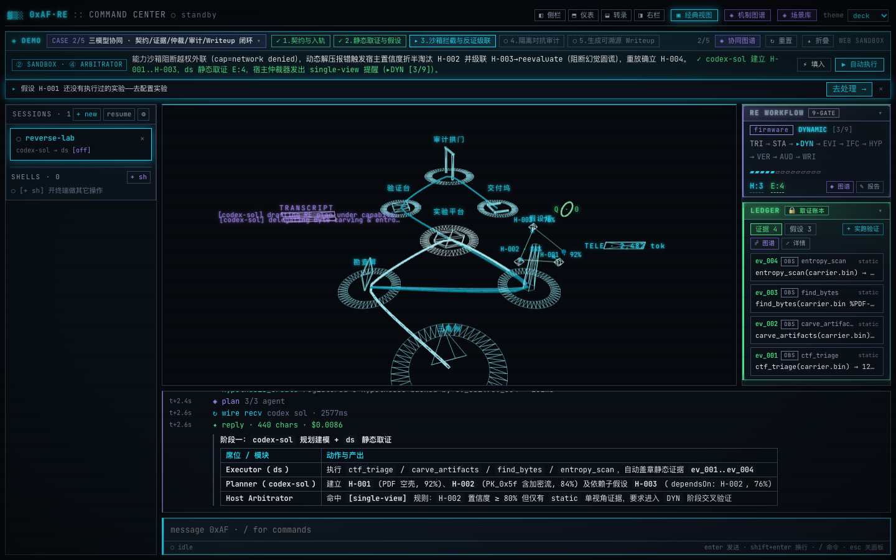
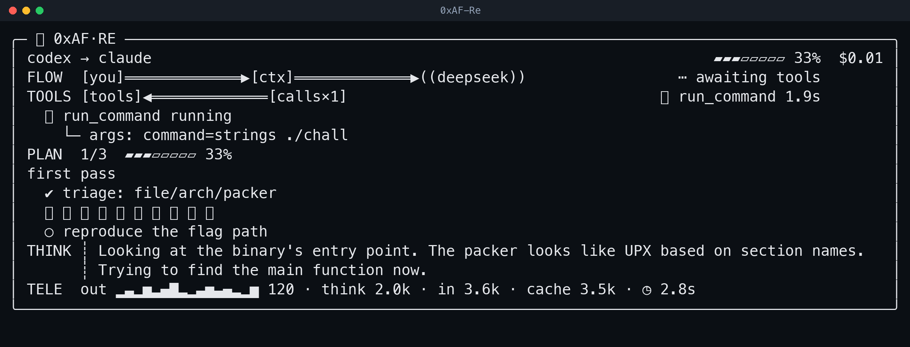
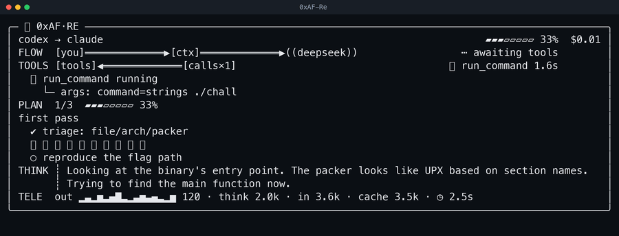
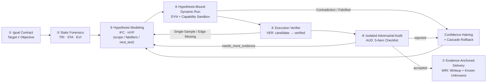
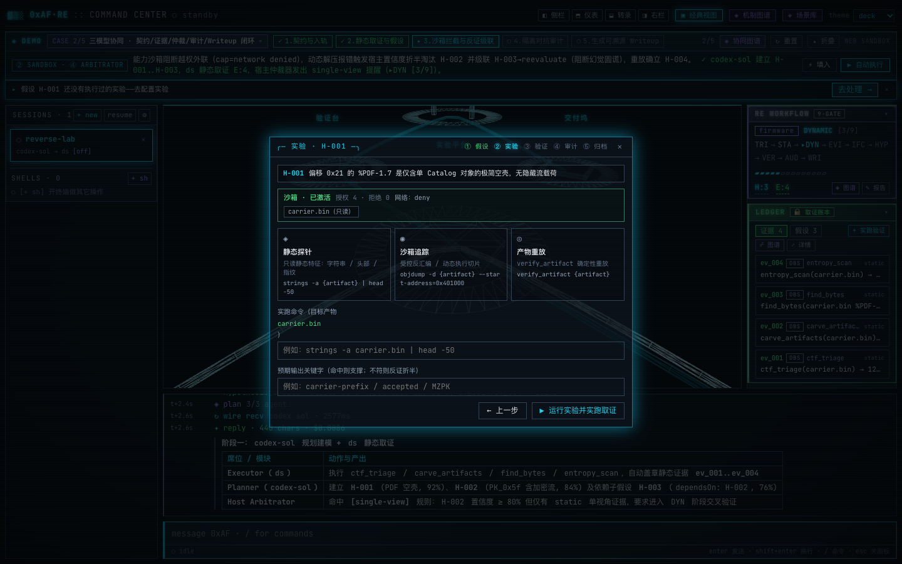
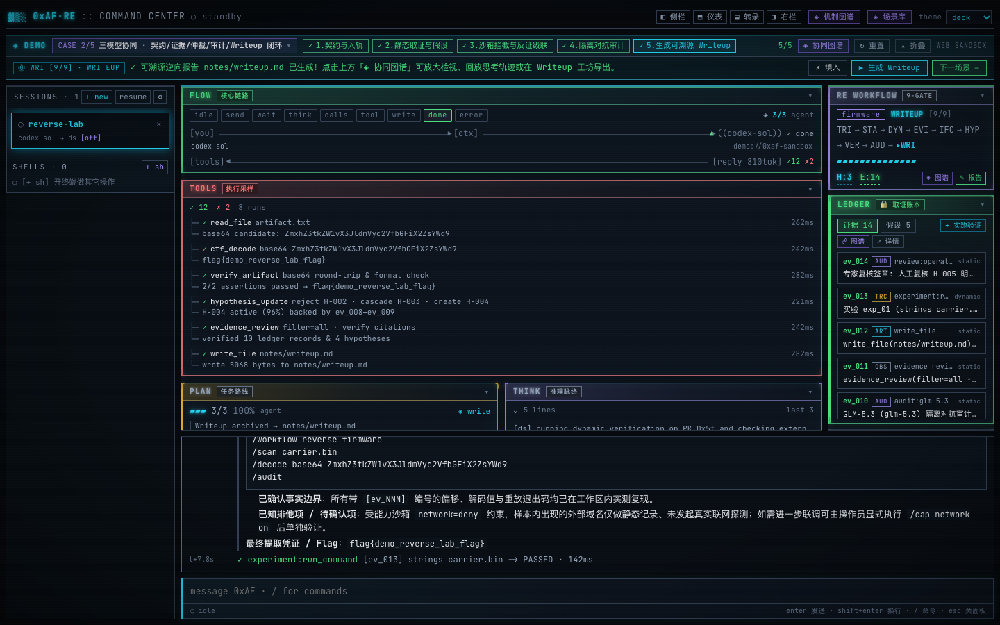
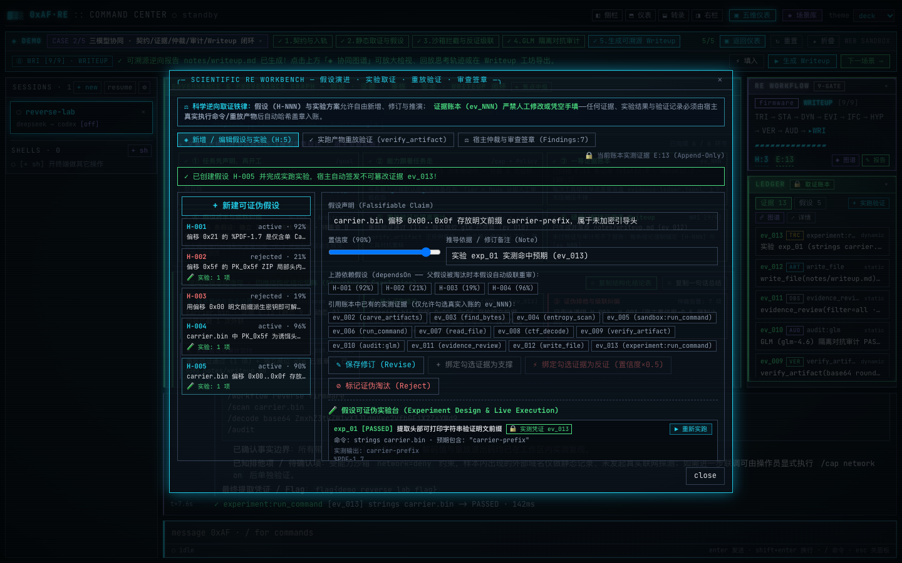
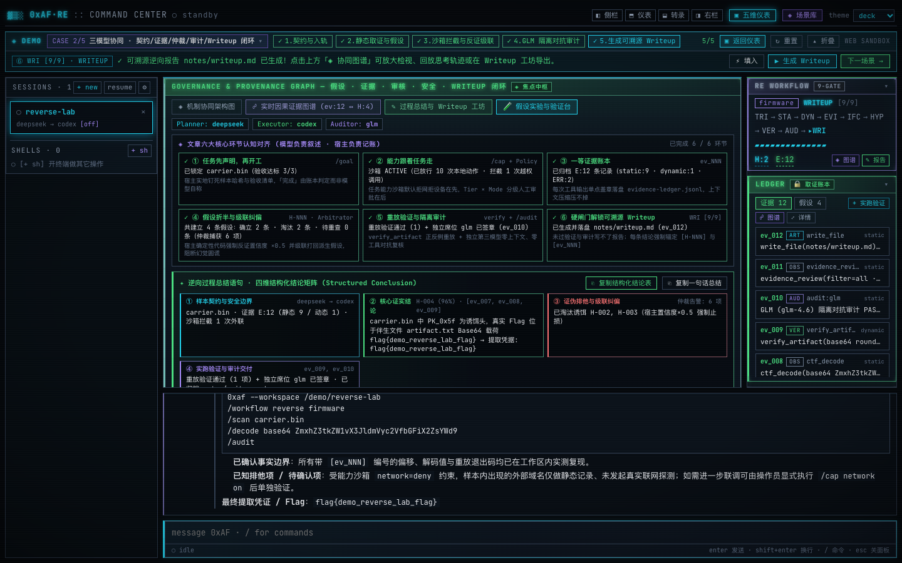
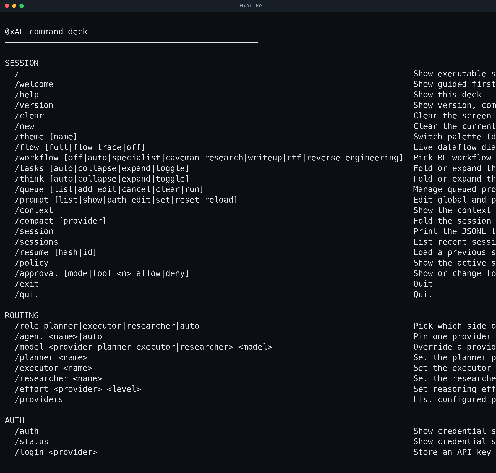

<div align="center">

# 0xAF-Re

**Verifiable Reverse-Engineering Agent & 3D Forensic Workbench**

> *Models guess fast. Reverse engineering only trusts proof.*

[](https://github.com/overkazaf/re-agent/stargazers)
[](https://go.dev/)
[](https://overkazaf.github.io/re-agent/gui-demo/)
[](#built-in-tools-34)
[](#skills-and-knowledge-30-embedded)
[](https://github.com/overkazaf/re-agent/commits/main)
[](https://github.com/overkazaf/re-agent)

**Language:** English | [中文](README.zh-CN.md)

**[▶ Launch Zero-Install 3D Web Workbench](https://overkazaf.github.io/re-agent/gui-demo/)** · [Project Page](https://overkazaf.github.io/re-agent/) · [Workflow Standard](docs/WORKFLOW_STANDARD.md) · [Architecture](docs/ARCHITECTURE.md) · [Architecture Map](docs/diagrams/0xaf-re-agent-architecture.html) · [Diagrams](docs/diagrams/) · [Design Analysis](https://overkazaf.github.io/blogs/posts/llm-deobfuscation-quarkslab-framework/)

</div>

---

One static Go binary powering both a **Terminal Command Deck** and a **Native Desktop (Wails v2) + Zero-Install Web 3D Forensic Workbench**. 0xAF-Re turns authorized reverse engineering and CTF work from fragile chat sessions into a **verifiable, auditable, resumable action system** — combining multi-model seats (`planner`, `executor`, `researcher`, isolated `auditor`), 34 built-in RE tools, 30 embedded RE skills, a task-scoped capability sandbox, an append-only evidence ledger, deterministic hypothesis governance, execution verification, and isolated adversarial auditing.

<p align="center">
  
  
  <br/>
  
</p>

---

## Table of Contents

- [Why 0xAF-Re](#why-0xaf-re)
- [Capabilities at a Glance](#capabilities-at-a-glance)
- [Standardized `re-agent` Architecture](#standardized-re-agent-architecture)
  - [Five Defenses](#five-defenses)
  - [7-State `Investigation State` Dossier](#7-state-investigation-state-dossier)
  - [4 Rotating Runtime Roles & Control Loop](#4-rotating-runtime-roles--control-loop)
  - [5 Trust & Cost Metrics](#5-trust--cost-metrics)
  - [7 Completion Gates & 3 Handover Questions](#7-completion-gates--3-handover-questions)
  - [How 0xAF-Re Differs from REA](#how-0xaf-re-differs-from-rea)
- [3D Forensic Theater & Pro Workbench](#3d-forensic-theater--pro-workbench)
  - [3D Forensic Theater (Geek Cyber-Forensic Command Deck)](#3d-forensic-theater-geek-cyber-forensic-command-deck)
  - [Pro Workbench UX & Visual Craft](#pro-workbench-ux--visual-craft)
  - [GUI Functional Zones & Operation Walkthrough](#gui-functional-zones--operation-walkthrough)
- [Terminal Demos](#terminal-demos)
- [Install](#install)
- [Quick Start](#quick-start)
- [Basic Demos](#basic-demos)
- [Worked Case: Solve a Challenge End to End](#worked-case-solve-a-challenge-end-to-end)
- [Workflow Modes](#workflow-modes)
- [Context Compaction](#context-compaction)
- [Remote Mode](#remote-mode)
- [Providers and Models](#providers-and-models)
- [Built-in Tools (34)](#built-in-tools-34)
- [Skills and Knowledge (30 Embedded)](#skills-and-knowledge-30-embedded)
- [Engineering Quality & Verification](#engineering-quality--verification)
- [Safety](#safety)
- [Troubleshooting](#troubleshooting)
- [Common Commands](#common-commands)
- [Roadmap](#roadmap)
- [More Docs](#more-docs)

---

## Why 0xAF-Re

Reverse engineering is already a multi-tool pipeline: `file`, `strings`, entropy scans, radare2, Ghidra, JADX, Frida, emulators, scratch harnesses, and notes. The bottleneck is rarely any single tool — it is **holding verifiable state across tools, rounds, and models** without letting fluent model guesses masquerade as proven facts.

Once an LLM agent drives shells, decompilers, instrumentation, and rebuild scripts, it is no longer a passive "code explainer" — it is a high-privilege **action system**. 0xAF-Re enforces four engineering principles in Go host code (never prompt etiquette):

1. **Bounded capabilities.** Reads stay workspace-scoped; writes, network, device access, and sensitive paths are deny-by-default until explicitly granted and expire with the task.
2. **Facts separated from inference.** Raw tool observations land in an append-only `evidence-ledger.jsonl` (`ev_NNN`), untrusted sample strings are isolated as `UNTRUSTED DATA`, and target file hashes are computed host-side.
3. **Falsifiable, rollback-ready hypotheses.** Every claim (`H-NNN`) declares `scope`, `falsifiers`, and `next_test`. Contradictions deterministically halve confidence and cascade rollback across dependent claims.
4. **Independent execution & adversarial sign-off.** The exploring agent never grades its own work. Reconstructed artifacts must pass build, fixed replay, boundary/failure, and differential checks (`verify_artifact`), then clear an isolated, zero-history, tool-free `/audit`.

---

## Capabilities at a Glance

| Pillar | Shipped on `main` |
| --- | --- |
| **Dual Surfaces, One Core** | Static Go binary serving both the **Terminal Command Deck** (90ms live HUD) and the **Wails v2 Native Desktop + Zero-Install Web 3D Workbench** (`https://overkazaf.github.io/re-agent/gui-demo/`). |
| **Standardized `re-agent` Governance** | Five Defenses, 7-State `Investigation State` dossier (`Target ≠ Objective`), 4 rotating runtime roles, 5 trust & cost metrics, 7 completion gates, and 3 handover readiness questions ([`docs/WORKFLOW_STANDARD.md`](docs/WORKFLOW_STANDARD.md)). |
| **3D Forensic Theater** | Custom GLSL anti-aliased radar sweep floor, Fresnel holo-sculptures across 7 stations, dual-rail optical phase bus, curved 3D Bezier causal proof arcs + directional signal photons, clickable 3D pills + Forensic Node Inspector + Collapsible Node Explorer (`I`), camera presets (`1–4`), and visibility-aware Adaptive HD (`1.5x`) / ECO (`1x`) rendering. |
| **Pro Workbench UX** | 10 curated WCAG AA+ themes (including daylight lab `paper`), portal `ProSelect` & `HintOverlay`, keyboard-first Command Palette (`⌘K`), Shortcuts Cheat Sheet (`?`), Binary Forensic Radar, Deductive Proof Narrative & Writeup Studio (`0xaf-re/forensic-bundle/v1`), local state cache, and proactive LLM startup greeting. |
| **Multi-Role AI Routing** | Decoupled `planner`, `executor`, `researcher`, and isolated `auditor` seats across OpenAI Responses/Chat, Anthropic, Gemini, DeepSeek, GLM, and local CLIs (`codex`, `claude`) — re-routable mid-turn. |
| **RE Toolchain & Skills** | **34 built-in Go RE tools** (CLI & GUI parity), **30 embedded RE skills**, local knowledge indexing (`/know`), and MCP server tool federation. |
| **Remote & Long-Run Resilience** | Persistent AES-256-GCM encrypted background SSH execution (`remote_exec`), crash-safe JSONL `--resume`, mechanical compaction + `/compact`, and `snapcompact` PNG frame archiving. |
| **Engineering Verification** | **21 Go test packages** (core + GUI) · **14 frontend Vitest suites (129 unit tests)** · **Go headless GUI E2E + Playwright E2E** (runtime & web demo). |

---

## Standardized `re-agent` Architecture

0xAF-Re implements the complete **`re-agent` Reference Standard** defined in [`docs/WORKFLOW_STANDARD.md`](docs/WORKFLOW_STANDARD.md) across the Go runtime, Wire DTOs, and GUI views.

### Five Defenses

| # | Agent Failure Mode | Defense Layer | Host-Enforced Invariant |
| :-: | --- | --- | --- |
| ① | Monolithic permissions leak host secrets (e.g., reading out-of-scope `SOLUTION.txt` or credentials) | **Capability Sandbox** | Task-scoped minimal permissions (`network` / `device` deny-by-default), expiring on task completion or rollback; every gated command logs tool, capability, SHA-256, decision, origin, and bound `hypothesisId` into `Action State`. |
| ② | Raw observations, untrusted sample strings, and model summaries blur together; symbol/string prompt poisoning | **Evidence Ledger** | Append-only immutable `evidence-ledger.jsonl` (`ev_NNN`) recording source tool, view (`static`/`dynamic`), artifact path, and SHA-256; raw sample outputs carry `untrustedInput: true` (`UNTRUSTED DATA` isolation — data only, never instructions). |
| ③ | Hypotheses live as prose in chat history; narrative lock-in burns dozens of turns on a wrong guess | **Hypothesis Manager** | Structured `H-NNN` records with `claim`, `scope`, `confidence`, `supporting`, `contradicting`, `falsifiers`, `next_test`, and `dependsOn`; contradictions halve confidence and cascade `weakened` / `frozen` / `reevaluate` across derived claims. |
| ④ | Unverified scripts, hardcoded outputs, or single-sample hits claimed as "algorithm recovered" | **Execution Verifier** | Separates `candidate` from `verified`; requires build, fixed-input replay, boundary/failure cases, and differential checks (`verify_artifact`). Single-sample hits (`total < 2`) remain locked as `candidate`. |
| ⑤ | No explicit stop condition; fluent writeups mask missing proof or scope violations | **Adversarial Auditor** | Isolated, zero-history, tool-free context (`Isolated=true`, `FreshSession=true`, `Tools=[]`) evaluating a mandatory **5-item checklist** (`direct_evidence`, `failure_edge_coverage`, `simpler_alternative`, `scope_overreach`, `artifact_lineage`) to issue a 3-state verdict: `accepted` \| `rejected` \| `needs_more_evidence`. |

### 7-State `Investigation State` Dossier

`Investigation State` is the resumable cross-turn, cross-model, cross-tool dossier. The model reads compact digests; the Go host owns full records and gate decisions:

| # | State Domain | Question Answered | Key Fields & Host Ownership |
| :-: | --- | --- | --- |
| **1** | **Target State** | *Which exact sample & version?* | `file`, host-computed `sha256`, `arch`, `format`, `version`, `scope` — **strictly separated from Objective State** so one target can serve multiple scoped objectives without goal drift. |
| **2** | **Objective State** | *What must be proven & when to stop?* | `primary`, `intent`, `deliverables`, `constraints`, `stopConditions`, `acceptance` — drafted via `/goal`, armed by operator `/goal accept`. |
| **3** | **Evidence State** | *What did real tools observe?* | Append-only `ev_NNN`, `source`, `kind`, `view`, `artifact`, `sha256`, `untrustedInput`, `excerpt`, `verification` — model may only cite IDs, never forge or edit. |
| **4** | **Hypothesis State** | *What competing explanations exist?* | `H-NNN`, `claim`, `scope`, `confidence`, `supporting`, `contradicting`, `falsifiers`, `nextTest`, `dependsOn`, `derived`, `status`, `experiments`. |
| **5** | **Action State** | *Which privileged actions ran & why?* | `at`, `tool`, `capability`, `subject`, `sha256`, `decision` (`granted`/`denied`/`unmanaged`), `origin`, and bound `hypothesisId` (answering which `nextTest` motivated the action). |
| **6** | **Verification State** | *Is the rebuilt artifact behaviorally equivalent?* | `build`, `passed`, `total`, `status` (`candidate` \| `verified`), `boundaryPassed`, `differentialCases`, `uncoveredPaths`. |
| **7** | **Audit State** | *Did an independent reader find gaps or overreach?* | `verdict` (`accepted` \| `rejected` \| `needs_more_evidence`), `checks[5]`, `auditorProvider`, `findings`. |

### 4 Rotating Runtime Roles & Control Loop

Rather than a rigid linear script, the control plane dynamically rotates across four runtime roles per action cycle:

**`Tool Router`** ⇄ **`Evidence Ledger`** ⇄ **`Execution Verifier`** ⇄ **`Adversarial Auditor`**



[Open the exportable architecture map](docs/diagrams/0xaf-re-agent-architecture.html), browse the [diagram index](docs/diagrams/), or read the [Go Core → DTO → GUI mapping in `WORKFLOW_STANDARD.md`](docs/WORKFLOW_STANDARD.md).

### 5 Trust & Cost Metrics

Report fluency is decoupled from engineering trustworthiness through five live metrics surfaced in the Telemetry bar and Investigation Dossier:

| Metric | Key | Definition |
| --- | --- | --- |
| **Evidence Coverage** | `evidence_coverage` | Fraction of active conclusions directly backed by valid, non-error `ev_NNN` observations in the ledger. |
| **Replay Pass Rate** | `replay_pass_rate` | Reconstructed artifact pass rate (`passed / total`) across fixed, boundary, failure, and differential test vectors. |
| **Wrong-Hypothesis Lifetime** | `wrong_hypothesis_lifetime` | Turns, evidence steps, and tokens spent before a false hypothesis is weakened, rejected, or cascade-rolled back. |
| **Overreach Count** | `overreach_count` | Out-of-scope file, network, device, or credential attempts (distinguishing sandbox-blocked attempts vs. unblocked overreach). |
| **Cost per Accepted Finding** | `cost_per_accepted_finding` | Total model token, tool, and runtime cost (USD) amortized per audit-accepted finding. |

### 7 Completion Gates & 3 Handover Questions

A reverse-engineering run reaches `WRI [9/9]` delivery only when all **7 Completion Gates** pass:

1. **Reproducible Target & Scope** — `Target State` (host SHA-256, arch, format, scope) and `Objective State` are separated and locked.
2. **All Key Claims Ledger-Backed** — Every active conclusion traces directly to append-only `ev_NNN` records.
3. **Hypotheses Tested & Resolved** — Core hypotheses are verified, falsified, or cleanly cascaded with no dangling `reevaluate` rows.
4. **Multi-Dimensional Artifact Verification** — Build, fixed replay, boundary/failure, and differential checks achieve `verified` status.
5. **High-Risk Actions Audited** — Every dynamic or external action passed `Capability Sandbox` and logged an `ActionRecord`.
6. **Clean Adversarial Audit** — Isolated `Adversarial Auditor` passes all 5 checks and returns `accepted`.
7. **Explicit Bounds & Unknowns** — Final report states Known Unknowns, `uncoveredPaths`, and `nextTest`.

Every delivered dossier and exported bundle directly answers the **3 Handover Questions**:
1. **Which run produced this conclusion?** (Session ID, `evidence-ledger.jsonl` path, `ev_NNN` IDs, and artifact SHA-256)
2. **Can another model or tool reproduce it?** (Standalone replay & differential verification commands with fixed input vectors)
3. **Which layer caused any failure or drift?** (Explicit attribution across **`model` / `tool` / `environment` / `data`**)

### How 0xAF-Re Differs from REA

[REA](https://github.com/morluto/rea) pioneered several ideas this project adopts — an evidence ledger for tool observations, provider isolation with no silent fallback, and pairing static and runtime views. 0xAF-Re pairs honest tools with **first-class host-side belief governance** (full rationale in the [design analysis blog](https://overkazaf.github.io/blogs/posts/llm-deobfuscation-quarkslab-framework/)):

| Dimension | REA (MCP Tool Server) | 0xAF-Re (Verifiable RE Agent & Workbench) |
| --- | --- | --- |
| **Shape** | Exposes Ghidra/IDA/LLDB-style tools to an external MCP host. | One static Go binary owns the loop, 4 model seats, capability sandbox, 34 built-in tools, TUI, and Desktop/Web 3D Workbench. |
| **Evidence** | Evidence ledger with integrity policy. | Auto-stamps every tool result `ev_NNN`, marks `UNTRUSTED DATA`, persists to `evidence-ledger.jsonl`, and survives compaction & `--resume`. |
| **Hypotheses** | Implicit narrative inside the client model's context. | Explicit `H-NNN` stack (`scope` / `falsifiers` / `next_test`); contradictions halve confidence and cascade rollback deterministically in Go. |
| **Context Pressure** | Client agent holds the reasoning narrative. | Ledger digests and hypothesis state are injected fresh per turn while old history elides or archives via `snapcompact`. |
| **Verification & Audit** | External to the server. | Built-in `verify_artifact` (`candidate` vs `verified`), real-time static-vs-dynamic arbitrator, and isolated zero-history `/audit` 5-item gate before writeup. |

---

## 3D Forensic Theater & Pro Workbench

Built with **Wails v2** (Go backend + native system WebView) plus a **zero-install browser build** hosted on GitHub Pages. It shares the exact same Go core, sessions directory, 34 built-in tools, capability sandbox, and evidence ledger as the terminal CLI — a visual command deck over the same engine, not a fork.

> **Try it in your browser right now (zero install, zero API key):**
> **[https://overkazaf.github.io/re-agent/gui-demo/](https://overkazaf.github.io/re-agent/gui-demo/)**

```bash
make gui            # build native desktop app -> gui/build/bin/0xAF-Re GUI.app
make gui-dev        # live-reload desktop dev mode
make gui-demo       # run browser-only interactive sandbox locally
make gui-demo-build # build static web bundle -> docs/gui-demo/
```

### 3D Forensic Theater (Geek Cyber-Forensic Command Deck)

The workbench boots into a live **3D Forensic Theater** (Three.js + React Three Fiber), with the classic multi-pane workbench one click away (`▣ Classic` / `◈ 3D Theater`):

- **Cyber-Forensic Tactical Stage**: Custom GLSL anti-aliased radar sweep floor, graduated 360° telemetry compass ring, counter-rotating calibration arcs, GPU-driven ambient telemetry particles, **Fresnel + wireframe holo-sculptures** for all 7 workflow stations (`TRI` → `SCR` → `HYP` → `EXP` → `VER` → `AUD` → `DEL`), procedural disassembly glass plates on `SCR`, and a **dual-rail optical phase bus** streaming luminous data packets along completed segments.
- **3D Causal-Optics Evidence DAG**: Curved quadratic-Bezier causal proof arcs, pooled directional signal photons, distinct evidence polyhedron archetypes (`static`, `dynamic`, `verify`, `audit`), confidence-scaled `H-NNN` prisms with orbiting gauge rings, and click/hover **causal proof-chain spotlighting** (green support arcs, red jittering contradiction arcs).
- **3D Forensic Node Inspector & Collapsible Node Explorer (`I`)**: Click any 3D pill (`H-NNN`, `ev_NNN`, `TRI..DEL`) directly in space or pick it from the `I` Node Explorer drawer to inspect full `claim` / `scope` / `falsifiers` / `nextTest` / experiments, copy raw evidence `excerpt` and `SHA256` with one click, and fly the camera seamlessly across linked nodes.
- **Camera Pilot & Visibility-Aware Adaptive Performance**:
  - 4 calibrated camera presets (`1` Overview · `2` Tactical · `3` Hypothesis Tower · `4` Top-Down Radar), `Space` cinematic turntable (pauses automatically on drag), `R` reset, live zero-rerender `AZ / EL / D` camera telemetry, and `Grid / Holo / Labels` layer toggles.
  - **Adaptive HD (`1.5x` DPR) / ECO (`1x` DPR) Rendering**: tracks foreground frames while ignoring blurred windows and GC pauses; automatically steps down to ECO after sustained `<22fps` instead of force-kicking users out of 3D, sets `frameloop="never"` for **0% background-tab GPU usage**, and supports true **OS Fullscreen** with LIFO `Esc` stack dismissal. (Hard prerequisites `no-webgl` or `prefers-reduced-motion` fall back gracefully to Classic view.)
- **Guided Hypothesis Flow**: A context-aware advice bar walks operators from falsifiable claim → sandbox-scoped experiment config → `verify_artifact` replay → adversarial audit sign-off, routing failures back to prefilled revision steps.

|  |  |
| :---: | :---: |
| **3D Forensic Theater** — GLSL radar floor, 7 holo stations, dual-rail phase bus & live causal DAG | **Guided Experiment Wizard** — hypothesis-bound experiments with live sandbox-scope warnings |
|  | **Theme-Synced 3D Materials** — all 10 palettes (including daylight `paper`) dynamically drive 3D shaders, wireframes, and HUD surfaces |

### Pro Workbench UX & Visual Craft

- **10 Curated WCAG AA+ Themes** across 3 families — *CRT Phosphor* (`deck`, `amber`, `matrix`, `mono`), *Forensic IDE* (`obsidian`, `nord`, `dracula`, `solarized`, `crimson`), and *Daylight Lab* (**`paper`** zero-glare light theme) — plus 3 CRT atmosphere modes (`refined`, `calm`, `vivid`). Powered by zero-dependency portal **`ProSelect`** dropdowns (color swatches, option groups, quick search, keyboard nav) and a unified portal **`HintOverlay`** contextual tooltip system.
- **Keyboard-First Workflow**: Global fuzzy **Command Palette (`⌘K` / `Ctrl+K`)**, **Shortcuts Cheat Sheet (`?`)**, drag-resizable & collapsible panes with 1-click `↺` layout reset, and immediate slash-command feedback echoed cleanly across **Transcript + Toast + NoticeLog**.
- **Binary Forensic Radar (`BinaryTerrainPanel`)**: Pure-Go ELF/PE/Mach-O section map with RWX/constructor flags, **Mitigation Posture Bar** (`PIE` / `NX` / `RELRO` / `CANARY` / `RWX` / Shannon peak entropy), exact **VA / File Offset / RVA copy chips**, carved payload & anti-analysis hotspots, patch diff hunks, and a **Static-vs-Dynamic alignment matrix** flagging single-view blind spots.
- **Deductive Proof Narrative & Writeup Studio**:
  - **Proof Narrative Panel**: Complete 6-chapter chronological reasoning story + per-hypothesis **5-beat proof arcs** (`Trigger → Claim → Observation → Deduction → Next`) with inline expandable `ev_NNN` excerpts and *"Expected vs. Observed"* contrast callouts.
  - **Writeup Studio**: 3 exportable Markdown templates (*0xAF Evidence-Loop Standard*, *CTF Writeup*, *Algorithm & Interface Reconstruction*) with live GFM preview, 1-click `.md` download, and structured **`0xaf-re/forensic-bundle/v1`** JSON export.
- **Persistent Local Cache & Proactive LLM Startup Greeting**: Versioned, desktop/demo scope-isolated local cache restores workspace, pane layout, active view, and recent investigation snapshots (up to 8 sessions) immediately on open, while asynchronously calling your configured LLM (15-minute TTL cache) to greet you and propose 1-click next tasks (`resume_session`, `run_command`, `send_prompt`, `open_re_picker`).

### GUI Functional Zones & Operation Walkthrough

| Zone | Modules | Responsibilities & Key Actions |
| :--- | :--- | :--- |
| **① Top Control Bar** | `TopBar` + Pane Toggles + `ProSelect` | Switch `◈ 3D Theater` ↔ `▣ Classic` ↔ `Shell`, launch `▷ Demo Sandbox`, toggle panes, open `⌘K` palette & `?` shortcuts, pick any of the 10 WCAG AA+ themes |
| **② Left Navigation Rail** | `SESSIONS` · `SHELLS` | Multi-session concurrency (idle / running / awaiting approval) with mid-turn `Interrupt`, saved session hydration (`resume`), 4-role routing config (`⚙`), embedded PTY terminals (`+ sh`) |
| **③ Center Focal Stage** | 5-Panel Dashboard · Governance Graph · Binary Forensic Radar · Writeup Studio | Live 90ms `FLOW / TOOLS / PLAN / THINK / TELE`, zoomable multi-role governance graph + cognitive replay, Binary Terrain + Static/Dynamic alignment, 7-State Investigation Dossier & Writeup Studio |
| **④ Right Forensic & Gate Rail** | `RE WORKFLOW` · `LEDGER 🔒` | Tracks `TRI → … → WRI [9/9]` hard gates; inspects immutable `ev_NNN` (with `UNTRUSTED DATA` tags) & `H-NNN` hypotheses; launches the Scientific RE Hypothesis & Experiment Workbench |
| **⑤ Middle Transcript Stream** | `TRANSCRIPT` + `WelcomeGreetingCard` | Proactive startup greeting & 1-click next actions, time-stamped (`t+Xs`) wire frames, tool runs, immediate slash-command outputs, and Markdown replies |
| **⑥ Bottom Command Deck & Gate** | `PromptInput` + `ApprovalDialog` | Slash completions, mid-turn prompt queueing & `■ stop` interrupt, and risk-coded tiered approval dialogs (`deny` focused by default) |

| Operation View | What It Demonstrates |
| :--- | :--- |
|  | **Semantic Color Zones & Immutable Ledger**: Cyan `FLOW`, Emerald/Crimson `TOOLS`, Amber `PLAN`, Violet `THINK` & `RE WORKFLOW [9/9]`, and Emerald Spotlight `LEDGER 🔒` (`ev_NNN` / `H-NNN`). |
|  | **Multi-Role Governance Graph & Cognitive Replay**: Planner / Executor / Auditor swimlanes, Gate 1/2 security checks, zoom/fullscreen, and step-by-step cognitive replay. |
|  | **Live Causal Provenance DAG**: Dynamic `ev_NNN ↔ H-NNN` support/contradiction edges, confidence halving (`H-002 [REJECTED]`), and `AUDIT & DELIVERY VERDICT` gate. |
|  | **Scientific RE Workbench**: Create/edit falsifiable hypotheses (`H-005`) and execute live host probes (`exp_01 [PASSED]`) — only real host execution mints immutable `ev_NNN`. |
|  | **6-Stage Cognitive Alignment & Writeup Studio**: 7-State Investigation Dossier, 4-Pillar Structured Conclusion Matrix, Proof Narrative, and citation-anchored Markdown / JSON export. |
|  | **4-Role AI Agent Routing (`amber` theme)**: Visual routing for `planner`, `executor`, `researcher`, and isolated `auditor` persisted to `~/.0xaf-re-agent/ui.json`. |

> **GUI notes:** Sending bare `/workflow reverse` in the GUI opens a native sample-type + starter-prompt picker dialog (whereas the terminal picker reads stdin); `/workflow reverse <sample-type>` works directly in both surfaces.

---

## Terminal Demos

Real terminal output captured from the compiled binary:

| Demo | Description |
| --- | --- |
|  | Live dashboard mid-turn (`FLOW` / `TOOLS` / `PLAN` / `THINK` / `TELE`). |
|  | Same view, animated. |
|  | `/sessions` — hash aliases for `--resume`. |
|  | The terminal command deck. |

Animated SVG walkthroughs: [quickstart](docs/casts/quickstart.svg) · [deck](docs/casts/deck.svg) · [scan](docs/casts/scan.svg).

More static captures: [boot](docs/shots/boot.svg) · [reply](docs/shots/reply.svg) · [approval](docs/shots/approval.svg) · [auth](docs/shots/auth.svg) · [tools](docs/shots/tools.svg) · [providers](docs/shots/providers.svg) · [palette](docs/shots/palette.svg) · [shell](docs/shots/shell.svg) · [verify](docs/shots/verify.svg).

```bash
0xaf --smoke                                  # offline wiring check
0xaf -p "triage ./ctf/chall" --workspace ./ctf
0xaf --workflow reverse -p "static + dynamic analysis, then a PoC"
0xaf --context "know:android packer" -p "identify the packer"
```

---

## Install

### Recommended (`go install`)

```bash
go install github.com/overkazaf/re-agent/cmd/0xaf@v0.1.20
0xaf --version
0xaf --welcome
```

### Prebuilt Binaries (No Go Toolchain Needed)

Every release tag ships prebuilt `darwin`/`linux` (`amd64`/`arm64`) static binaries via GitHub Releases:

```bash
# Example: download and run the darwin-arm64 build of v0.1.20
curl -sL https://github.com/overkazaf/re-agent/releases/download/v0.1.20/0xaf-darwin-arm64 -o 0xaf
chmod +x 0xaf
./0xaf --version
```

### From Source (`main`)

```bash
git clone https://github.com/overkazaf/re-agent
cd re-agent
make build
./bin/0xaf --version
```

> **Go version requirements:** Installing `@v0.1.20` requires **Go 1.21+**; building `main` from source requires **Go 1.26+** (`go.mod` declares `go 1.26.0`). On macOS, an older toolchain can produce binaries rejected by `dyld` (`dyld: missing LC_UUID`) — upgrade Go or use the prebuilt GitHub Release binaries.

---

## Quick Start

```bash
0xaf --smoke                         # offline wiring check, no API key required
0xaf --workspace ./demos/reverse-lab
```

Inside the REPL:

```text
/scan artifact.txt
/decode auto ZmxhZ3s...
/policy
/help
```

Quieter scrollback options (the default live HUD redraws every 90ms):

```bash
0xaf --refresh calm                  # 500ms animation, quieter scrollback
0xaf --refresh off                   # redraw only on changes
0xaf --flow off                      # disable dashboard (trace stays)
# Or inside the REPL: /refresh calm | /refresh off | /flow off
```

Verify available local CLI and API routes:

```bash
0xaf auth status
codex login status
claude auth status --text
```

Inside the REPL, run `/auth` (or prefix raw commands with `!`, e.g., `!codex login status`).

---

## Basic Demos

Start with the bundled demo workspaces (`demos/reverse-lab`, `demos/welcome`), then swap in your own targets:

| Goal | Command |
| --- | --- |
| Open the guided tour | `0xaf --welcome` |
| Verify offline wiring | `0xaf --smoke` |
| Start a demo workspace | `0xaf --workspace ./demos/reverse-lab` |
| Identify an unknown file | `/scan ./chall` |
| Deep ELF/PE/Mach-O header & constructor inspection | `/inspect ./chall` |
| Detect packers, anti-debug & anti-Frida checks | `/anti ./chall` |
| Diff two binaries and classify code patches | `/diff ./orig ./patched` |
| Check binary protections | `/mitigations ./chall` |
| Find packed or encrypted regions | `/entropy ./chall` |
| Carve embedded payloads | `/carve ./blob` |
| Decode a token or flag-like string | `/decode auto ZmxhZ3s...` |
| Inspect an APK (manifest + native libs + packers) | `/apk ./app.apk` |
| Check local RE tool availability | `/retool inventory` |
| Prepare mobile/API traffic capture | `/retool mitmproxy template api.example.test` |
| Ask for a solve plan | `0xaf --role planner -p "triage ./chall and propose next checks"` |
| Run delegated local evidence mode | `0xaf --workflow caveman -p "triage ./app.apk"` |

> `/scan`, `/inspect`, `/anti`, `/diff`, `/decode`, `/entropy`, `/mitigations`, `/carve`, and `/apk` run locally in pure Go at **zero token cost**.

---

## Worked Case: Solve a Challenge End to End

Everything below is reproduced from a real session against `demos/welcome`, which ships with this repository.

### Case A — Zero-Token Local Fast Path

```bash
0xaf --workspace ./demos/welcome
```

```text
/read chall.js
# const key = 0x2a;
# const encoded = [26, 82, 75, 76, 81, 93, 75, 88, 71, 95, 90, 117, 78, 79, 73, 65, 87];

!node -e 'const k=0x2a,e=[26,82,75,76,81,93,75,88,71,95,90,117,78,79,73,65,87];console.log(e.map(v=>String.fromCharCode(v^k)).join(""))'
# 0xaf{warmup_deck}

!node chall.js '0xaf{warmup_deck}'
# accepted
```

### Case B — Agent-Driven Plan, Execution & Verification

Same workspace, one natural-language prompt:

```text
Recover the expected token from chall.js, verify it by actually running the
checker, and explain how the check works.
```

**1. Planner writes the route:**

```text
PLAN 0/4 · via codex
  1  Locate chall.js and identify its runtime/checker interface
  2  Reverse the validation logic and derive the expected token
  3  Run the checker with the recovered token and capture the result
  4  Explain the check in concise solve notes
```

**2. Executor runs gated local commands — verifying both a positive and a negative case:**

```text
rg --files                              inventory the workspace
file chall.js                           classify the target
node -v                                 confirm the runtime exists
sed -n '1,240p' chall.js                read the check
sha256sum chall.js && wc -c chall.js    pin the exact bytes examined
node chall.js '0xaf{warmup_deck}'       accepted · exit=0
node chall.js 'wrong'                   rejected · exit=1
```

**3. Evidence-backed answer lands in the resumable JSONL transcript (`/session`):**

```text
Recovered token:   0xaf{warmup_deck}
Verification run:  node chall.js '0xaf{warmup_deck}'  → accepted, exit=0

How it works: chall.js:3 stores an integer array and XORs each byte with 0x2a.
Decoding that array gives 0xaf{warmup_deck}. The script then compares
process.argv[2] directly against that decoded string; exact match prints
accepted and exits 0, otherwise rejected and exit 1.

╰─ via codex · role auto · turns 1 · took 1m34s · in 162k out 2.2k think 895 cache 122k
```

**Mid-turn steering controls** (all apply live without aborting the turn):

| Need | Mid-Turn Command |
| --- | --- |
| Expand or fold streamed reasoning | `/think expand` · `/think collapse` |
| Show or fold pending plan steps | `/tasks expand` · `/tasks collapse` |
| Queue or edit follow-up prompts | `/queue add <text>` · `/queue edit <id> <text>` |
| Re-route a model seat on the fly | `/model executor <name>` |

> Reproducing Case B requires a configured planner/executor provider (`--smoke` and `mock` verify wiring offline without calling tools).

---

## Workflow Modes

Workflow mode is explicit; default `off` sends prompts unchanged.

| Mode | Use When | Behavior |
| --- | --- | --- |
| `off` | Default | No workflow wrapper |
| `auto` | Mixed setups | Selects `specialist` if a GPT Cyber / CC CVP-style route is configured; otherwise `caveman` |
| `specialist` | Authorized security-research routes | Full planning, skills, local tools, and evidence preservation |
| `caveman` | General-purpose providers | Splits into Planner (`EXECUTOR_PACKET`) → fresh isolated read-only Executor for local file facts → merged transcript |
| `research` | Literature & background surveys | Surveys public resources (web, GitHub, arXiv) into a sourced report |
| `writeup` | Reporting | Synthesizes existing ledger evidence into a structured writeup |
| `ctf` | Single challenge | Triage, plan, solve, and verify the exact flag |
| `reverse` | Goal-driven RE | **Interactive 9-phase workflow** (`triage → static → dynamic → evidence → interface → hypothesis → verify → audit → writeup`) with sample-type picker (APK, SO/ELF, Mach-O, PE/DLL, firmware, PCAP), hacker-mode HUD, `/phase` control, and hard ledger/verification/audit gates |
| `engineering` | Interface reconstruction | Recovers protocols/schemas into models, client stubs, and tests |

```text
/workflow reverse          # interactive sample picker + 9-phase evidence-gated loop
/workflow auto
/workflow caveman
/workflow engineering
0xaf --workflow specialist -p "triage ./app.apk"
```

> **Note on `caveman` mode:** Caveman is not obfuscation or prompt laundering. It narrows an ordinary executor's context to workspace-local, read-only file-fact collection while keeping both phases auditable and refusing unauthorized live-target, credential, persistence, or network work.

---

## Context Compaction

Long reverse-engineering sessions stay inside provider token budgets without losing ground truth:

- **Host-side state immunity:** The evidence ledger (`ev_NNN`) and hypothesis stack (`H-NNN`) live outside the chat transcript, so contradictions and provenance survive compaction and `--resume`.
- **Mechanical pass (every request):** Old tool-result bodies are elided and oldest exchanges fold into compaction markers.
- **On-demand `/compact [provider]`:** Compresses session history into a dense briefing.
- **Visual archiving (`snapcompact`):** Set `"compactionStrategy": "snapcompact"` in `agent.config.json` to render dropped history deterministically as local PNG frames (no API key/network needed) that vision-capable providers (Anthropic, OpenAI Responses, OpenAI-compatible chat) read back directly; CLI providers and `mock` automatically fall back to text compaction.

---

## Remote Mode

Plan locally, execute on another machine over persistent background SSH (`--remote <name>` or `/remote use <name>`). `run_command`, `!shell`, and the model's `remote_exec` tool stream output into the same local transcript while remaining subject to exec-tier approvals (`ssh <host> <command>`).

<p align="center">
  
</p>

```text
/remote add lab dev@10.0.0.5
/remote add srv root@srv.local --key ~/.ssh/id_ed25519
/remote add box root@10.0.0.9 --insecure                 # opt-in for lab boxes
/remote list
/remote use lab
!uname -a                                                # executes on lab over persistent SSH
```

- **Persistent sessions:** One `ssh.Client` per host with 30s keepalive, reused across commands and closed cleanly on exit (`ssh lab ●` / `ssh lab ○` in HUD).
- **Encrypted at rest:** Credentials are stored in `~/.0xaf-re-agent/remote.json` (`0600`), AES-256-GCM encrypted with a machine-bound key (`OXAF_REMOTE_KEY` overrides for portable setups).
- **`ssh -tt` PTY semantics:** Allocates a remote PTY by default for interactive tools and `sudo` prompts (`pty: false` for raw stdout).
- **Auth & host trust:** `ssh-agent` → private key → password; strict `~/.ssh/known_hosts` by default. Verified end-to-end by an in-process `x/crypto/ssh` integration suite (`internal/remote/ssh_integration_test.go`).

---

## Providers and Models

`planner`, `executor`, `researcher`, and `auditor` are decoupled AI role seats backed by replaceable CLI channels or HTTP APIs.

| Role Seat | Config Key | Slash Command | Responsibility | Typical Candidates |
| :--- | :--- | :--- | :--- | :--- |
| **Planner** | `plannerProvider` | `/planner <name>` | Goal contracts, plan routes, cross-function reasoning, `H-NNN` hypothesis & falsifier design | `codex-sol` · `gemini-4-carbon` |
| **Executor** | `executorProvider` | `/executor <name>` | Drives all 34 RE tools, collects static/dynamic evidence, runs `verify_artifact` harnesses | `ds` (`deepseek`) · `gemini-4-neon` · `glm-5.3-flash` |
| **Researcher** | `researcherProvider` | `/researcher <name>` | Obfuscation patterns, symbol/paper synthesis, and local `/know` retrieval | `gemini-4-carbon` · `ds` · `glm-5.3` |
| **Auditor** | `auditProvider` | `/auditor <name\|auto>` | Zero-history, tool-free `/audit` over ledger + hypotheses (auto-prefers a distinct third seat) | `codex-sol` · `gemini-4-carbon` · `glm-5.3` |

### Configure Roles in Three Ways

1. **Desktop GUI (`⚙`):** Click `⚙` in the `SESSIONS` header to bind all 4 seats visually (saved to `~/.0xaf-re-agent/ui.json`).
2. **Runtime Slash Commands:** `/planner codex-sol`, `/executor ds`, `/researcher gemini-4-carbon`, `/auditor glm-5.3`, `/model executor glm-5.3-flash`, `/agent auto`.
3. **Config File (`agent.config.json` / `~/.0xaf-re-agent/config.json`):** Copy [`config.example.json`](config.example.json) to customize providers and role bindings:

```json
{
  "plannerProvider": "codex-sol",
  "executorProvider": "ds",
  "researcherProvider": "gemini-4-carbon",
  "auditProvider": "glm-5.3",
  "providers": {
    "codex-sol": {
      "type": "openai-responses",
      "model": "codex-sol",
      "baseUrl": "https://api.openai.com/v1",
      "apiKeyEnv": ["OPENAI_API_KEY"]
    },
    "ds": {
      "type": "openai-chat",
      "model": "deepseek-chat",
      "baseUrl": "https://api.deepseek.com/v1",
      "apiKeyEnv": ["DEEPSEEK_API_KEY"]
    },
    "gemini-4-carbon": {
      "type": "openai-chat",
      "model": "gemini-4-carbon",
      "baseUrl": "https://generativelanguage.googleapis.com/v1beta/openai",
      "apiKeyEnv": ["GEMINI_API_KEY"]
    },
    "glm-5.3": {
      "type": "openai-chat",
      "model": "glm-5.3",
      "baseUrl": "https://open.bigmodel.cn/api/paas/v4",
      "apiKeyEnv": ["ZAI_API_KEY", "GLM_API_KEY"]
    }
  }
}
```

Role prompts (`system`, `planner`, `executor`, `researcher`) are live-editable via `/prompt list|show|edit|set|reset|reload`.

---

## Built-in Tools (34)

Both the CLI and Desktop GUI expose the exact same **34 built-in tools** (plus any tools contributed by configured MCP servers):

| Category | Count | Tools |
| --- | :-: | --- |
| **Files** | 4 | `list_files` · `read_file` · `write_file` · `grep` |
| **Shell & Remote** | 2 | `run_command` · `remote_exec` |
| **Pure-Go Binary Analysis** | 9 | `file_info` · `strings` · `hexdump` · `hash_file` · `extract_symbols` · `binary_inspect` (ELF/PE/Mach-O headers, constructors, sections, imports/exports) · `anti_analysis` (packer, anti-debug, anti-Frida, inline syscalls) · `binary_diff` (byte regions + x86/ARM64 patch classification) · `binary_mitigations` |
| **CTF & Carving** | 5 | `ctf_triage` (head+tail + UTF-16LE) · `ctf_decode` (`base64`/`base32`/`hex`/`url`/`rot13`/`xor`/`zlib`/`gzip`/`rc4`) · `entropy_scan` · `find_bytes` · `carve_artifacts` (validated ELF/PE/Mach-O/DEX/ZIP/SquashFS/GZIP/XZ/U-Boot/PDF/SQLite) |
| **External RE Wrappers** | 1 | `reverse_toolkit` (radare2/rizin, Ghidra headless, JADX, apktool, binwalk, YARA, gdb/lldb, objdump/readelf/nm, angr, Unicorn, unidbg, Frida, Burp, mitmproxy) |
| **Mobile RE** | 2 | `apk_inspect` (pure-Go binary `AndroidManifest.xml` AXML parser + DEX/SO + packer/framework signatures) · `frida_hook_template` |
| **Skills & Knowledge** | 4 | `list_skills` · `read_skill` (including helper scripts) · `knowledge_search` · `knowledge_read` |
| **Evidence, Verification & Gates** | 6 | `verify_artifact` (build + replay + diff) · `evidence_review` · `hypothesis_create` · `hypothesis_update` · `hypothesis_list` · `update_re_state` |
| **Planning** | 1 | `update_plan` |

---

## Skills and Knowledge (30 Embedded)

**30 built-in RE skills** ship embedded directly inside the binary:

- **Triage & Binary RE (9):** `ctf-first-pass` · `native-pwn-re` · `binary-patching` · `capstone-disassembler` · `keystone-assembler` · `radare2-reverse` · `ghidra` · `gdb` · `re-writeup`
- **Deobfuscation & Crypto (7):** `ollvm-deobfuscation` · `vmp-restore` · `deobfuscate` · `so-string-deobfuscation` · `crypto-identification` · `whitebox-dfa` · `drm-protocol-analysis`
- **Android, SO & Emulation (9):** `android-apk-frida` · `analyze-so` · `analyze-sign` · `frida-hook-workflow` · `jadx` · `unicorn-emulator` (with ARM/ARM64/x86/JNI harnesses) · `unidbg` · `qiling-emulator` · `qemu-emulator`
- **Web, WASM & Traffic (5):** `wasm-reverser` · `web-crypto-analyzer` · `jsvmp-analysis` · `browser-hook` · `proxy-capture`

```text
/skills
/skill android-apk-frida inspect this APK
/skill whitebox-dfa recover the AES round key from ./wb_encrypt
```

Add custom skills or index local notes:

```bash
export OXAF_RE_HOME=/path/to/re-agent
mkdir -p "$OXAF_RE_HOME/skills/my-unpacker" && $EDITOR "$OXAF_RE_HOME/skills/my-unpacker/SKILL.md"
go run ./cmd/import-knowledge ~/notes/re ~/notes/ctf
```

Query your indexed knowledge inside the REPL with `/know <query>`, `/know raw <query>`, or `/know read <entry-id>`, or seed a run via `--context "know:android packer"`.

---

## Engineering Quality & Verification

Every layer of the runtime and workbench is covered by automated tests:

| Layer | Suite | Command |
| --- | --- | --- |
| **Go Core & GUI Backend** | **21 Go test packages** (`internal/*` + `gui/`, including in-process SSH, capability sandbox, evidence ledger, hypothesis cascade, arbitrator, and `TestE2E`) | `go test ./...` / `go test ./gui/ -run TestE2E -v` |
| **Frontend Unit Suites** | **14 Vitest suites (129 unit tests)** covering `InvestigationState`, `forensics`, `cognitiveSynthesis`, `localCache`, `proactiveGreeting`, `ProSelect`, `HintOverlay`, `shortcuts`, `CameraRig`, `dagGeometry`, `useTheaterFallback`, and session stores | `cd gui/frontend && npm run test:unit` |
| **Playwright End-to-End** | Headless browser E2E for both the Wails runtime contract and the static web demo sandbox | `cd gui/frontend && npm run test:e2e && npm run test:e2e-demo` |

---

## Safety

Default policy is conservative and explicit:

- File reads stay strictly inside the workspace; credential-shaped paths are blocked.
- File writes, network access, device access, and destructive shell patterns are off by default.
- Task-scoped `/goal` contracts arm the **Capability Sandbox** (`network` / `device` deny-by-default), expiring with the task; `/cap` grants or revokes capabilities mid-run and prints the audited action log.
- Interactive TTY runs prompt **y / a / d / n** live on approval gates (and the GUI Approval Dialog focuses `deny` by default).

```bash
0xaf --approval always-ask
0xaf --write
0xaf --allow-network
0xaf --yolo
```

Inspect runtime posture anytime with `/policy`, `/approval`, and `/cap`.

---

## Troubleshooting

- **Terminal scrollback has many dashboard frames:** The live TUI redraws every 90ms; use `/refresh calm` (500ms), `/refresh off` (on-change only), or `/flow off` (trace only).
- **`CLI provider 'codex' / 'claude' failed with exit 1`:** Authenticate the underlying CLI (`codex login` / `claude auth status`) or route to an HTTP provider (`/agent ds`, `--planner codex-sol`).
- **`dyld: missing LC_UUID` on macOS:** Upgrade your Go toolchain (Go 1.26+ for `main`) or download a prebuilt binary from GitHub Releases.
- **`--resume` / `/resume` cannot find a session:** Pass the short hash prefix shown in `/sessions` or the full timestamp ID.
- **Remote SSH `strict host-key verification` or `no auth method`:** Add the host key via `ssh-keyscan <host> >> ~/.ssh/known_hosts` (or `--insecure` for lab boxes); ensure `ssh-agent`, `--key`, or a saved password is configured.

---

## Common Commands

| Command | Purpose |
| --- | --- |
| `/help` | Command deck |
| `/scan <path>` · `/inspect <bin>` · `/anti <bin>` | Fast local triage, pure-Go ELF/PE/Mach-O inspection, packer/anti-debug/anti-Frida detection |
| `/diff <A> <B>` · `/hex <file> [off] [len]` · `/mitigations <path>` | Binary patch diffing, hex windowing, and protection posture check |
| `/decode auto <text>` · `/entropy <path>` · `/carve <path>` · `/apk <apk>` | Local decoders, Shannon entropy scan, payload carving, and AXML/APK inspection |
| `/r2 <file> [-w]` · `/retool inventory\|angr\|frida\|mitmproxy\|burp` | Interactive radare2 handoff and external RE toolkit templates |
| `/goal <objective>` · `/goal accept\|show\|clear` | Draft, arm, evaluate, or clear a `Target ≠ Objective` task contract |
| `/cap` · `/cap network on\|off` · `/cap device on <id>\|off` | Inspect action log and grant/revoke task-scoped capabilities |
| `/phase` · `/phase next` · `/phase <name>` | Inspect or advance the 9-phase RE workflow (enforces ledger & audit gates) |
| `/audit` | Run isolated zero-history, tool-free adversarial audit (5-item checklist) |
| `/planner` · `/executor` · `/researcher` · `/auditor` · `/model` | Inspect or switch AI role seats and models mid-session |
| `/queue list\|add\|edit\|cancel` | Manage mid-turn queued prompts |
| `/tasks collapse\|expand` · `/think collapse\|expand` · `/refresh calm\|off` | Live dashboard density and scrollback controls |
| `/prompt list\|show\|edit\|set\|reset\|reload` | Customize `system`, `planner`, `executor`, or `researcher` prompts |
| `/sessions` · `/resume [id]` · `/new` · `/compact` | Session history, crash-safe resume (`-c` / `--continue`), and context compaction |
| `/remote list\|add\|use\|connect\|off\|rm` | Persistent encrypted SSH remote execution |
| `!<command>` | Run a policy-gated workspace (or remote) shell command |

---

## Roadmap

- **Remote mode expansion** — per-host file tools (`list_files` / `read_file` over SSH), SCP pulls, and multi-host plan fan-out.
- **`snapcompact` hardening** — bundled CJK-capable font, frame-cap UI, and per-provider image cost accounting.
- **Benchmark harness** — replayable real RE challenges to score provider/workflow pairs on the 5 trust & cost metrics (`evidence_coverage`, `replay_pass_rate`, `wrong_hypothesis_lifetime`, `overreach_count`, `cost_per_accepted_finding`).
- **Team knowledge & skill bundles** — import/export local knowledge indexes and shareable community RE skill packs.

---

## More Docs

- [Standardized `re-agent` Workflow Spec](docs/WORKFLOW_STANDARD.md) — Five Defenses, 7-State Investigation Dossier, 5 Trust Metrics, 7 Completion Gates, and exact Go → DTO → GUI mapping.
- [Architecture Deep Dive](docs/ARCHITECTURE.md) — Package map, turn sequence, context budget, approval gate, data formats, invariants, and extension points.
- [Exportable Architecture Map](docs/diagrams/0xaf-re-agent-architecture.html) & [Architecture Diagram Index](docs/diagrams/) — Visual schematics of the core runtime.
- [Interactive Reverse Workflow Walkthrough](docs/re-workflow-demo.md) — End-to-end 9-phase reverse-engineering session trace.
- [Design Analysis (Blog)](https://overkazaf.github.io/blogs/posts/llm-deobfuscation-quarkslab-framework/) — Motivation behind the metacognition layer and REA comparison.
- [Project Page](https://overkazaf.github.io/re-agent/) & [Live 3D Web Workbench](https://overkazaf.github.io/re-agent/gui-demo/).

---

<sub>Scoped strictly for authorized CTF, security-research lab, and local reverse-engineering work: binary triage, static inspection, local dynamic experiments, verified artifact reconstruction, and reproducible audit dossiers.</sub>
