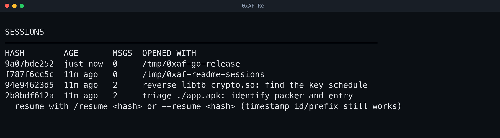
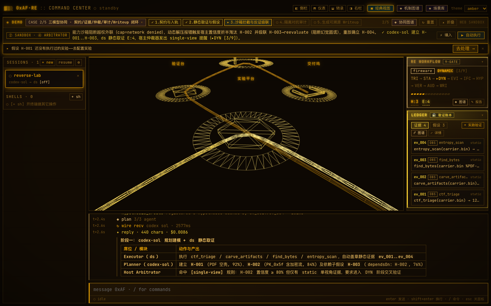
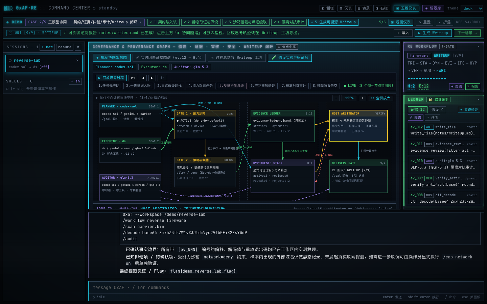
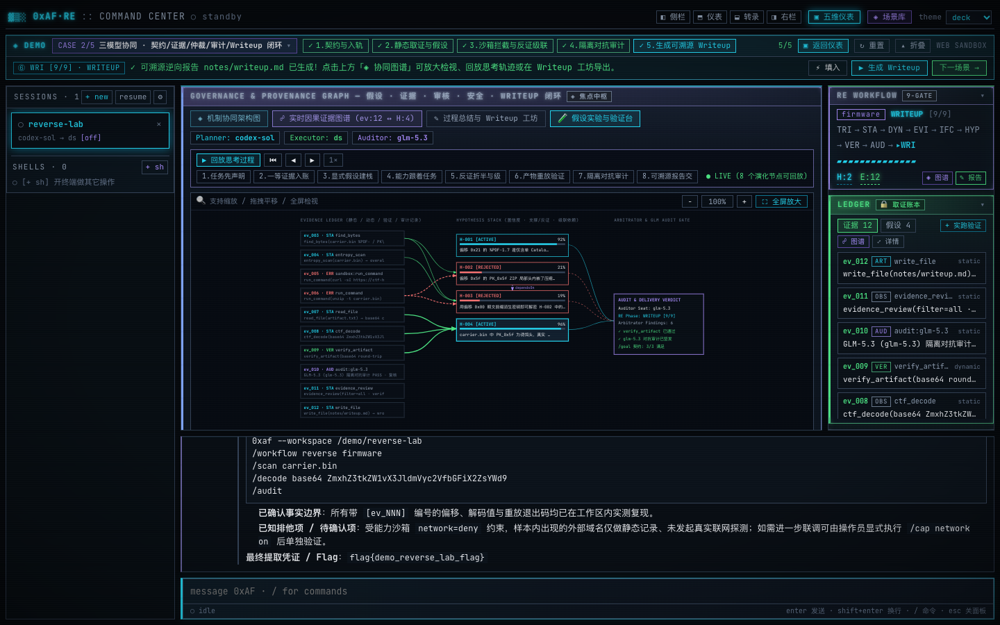
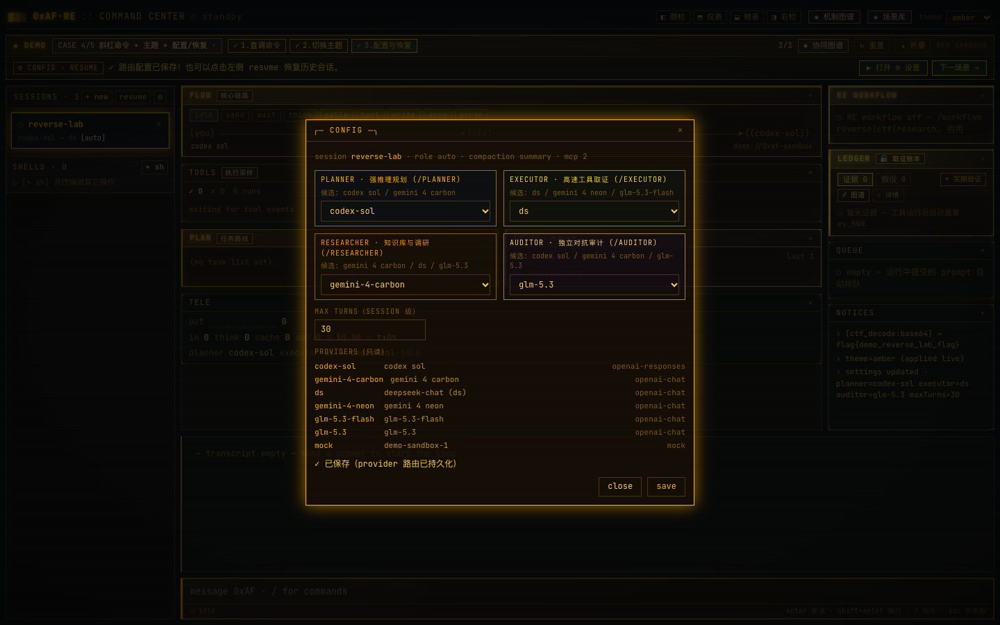
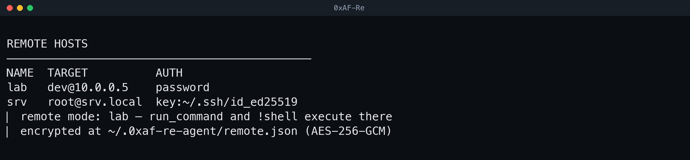

<div align="center">


</div>

# 0xAF-Re

An authorized reverse-engineering & CTF terminal agent. One static Go binary that
combines a **planner** and an **executor** model seat, local RE tools, workflow
modes, queued prompts, session resume, and a live view of every turn.

**Language:** English | [中文](README.zh-CN.md)

**Links:** [Project page](https://overkazaf.github.io/re-agent/) · [Architecture map](docs/diagrams/0xaf-re-agent-architecture.html) · [Architecture](docs/ARCHITECTURE.md) · [Architecture diagrams](docs/diagrams/) · [Comparison diagram](docs/diagrams/07-vs-oh-my-pi.svg) · [Design analysis (blog)](https://overkazaf.github.io/blogs/posts/llm-deobfuscation-quarkslab-framework/)

<p align="center">
  
  <br/>
  
</p>

## Table of Contents

- [Motivation](#motivation)
- [Features](#features)
- [Demos](#demos)
- [Architecture](#architecture)
- [Install](#install)
- [Quick Start](#quick-start)
- [Basic Demos](#basic-demos)
- [Worked Case: solve a challenge end to end](#worked-case-solve-a-challenge-end-to-end)
- [Desktop GUI](#desktop-gui)
- [Workflow Modes](#workflow-modes)
- [Context Compaction](#context-compaction)
- [Remote mode](#remote-mode)
- [Providers and Models](#providers-and-models)
- [Built-in Tools (34)](#built-in-tools-34)
- [Skills and Knowledge](#skills-and-knowledge)
- [Safety](#safety)
- [Troubleshooting](#troubleshooting)
- [Common Commands](#common-commands)
- [Roadmap](#roadmap)
- [More Docs](#more-docs)

## Motivation

Reverse engineering is already a pipeline: `file`, `strings`, `entropy`, r2,
JADX, Frida, a scratch script, and a note somewhere. The slow part is rarely any
single tool — it is **holding the thread across all of them** and re-deriving
what you already knew two hours ago. 0xAF-Re exists to keep that thread: a
planner model writes the route, an executor model drives the tools, and every
fact lands in a transcript you can resume, diff, and hand to someone else.

Three principles shape it:

1. **Local and evidence-first.** Reads stay inside the workspace; writes,
   network, and sensitive paths are off until you say otherwise. Facts come from
   real tools (`/scan`, radare2, JADX, Frida, …) before they come from a model.
2. **Two seats, not one.** A strong reasoner plans; a cheap executor collects
   evidence. `/planner`, `/executor`, and `/model` re-route at runtime.
3. **You watch it work and can steer mid-turn.** Plan rows, tool calls,
   reasoning, tokens, and timings render live; `/think expand`, `/tasks
   collapse`, `/queue edit`, `/model` take effect while the turn is running.

## Features

| Area | What you get |
| --- | --- |
| **Live dashboard** | One boxed view: FLOW (animated dataflow strip), TOOLS (tool cards), PLAN (task list + progress), THINK (reasoning tail), TELE (throughput/tokens/clock). Tight terminals shrink panel by panel down to the current step. |
| **Dual-model routing** | planner / executor / researcher seats, pinned or per-role, switchable mid-run. |
| **Workflow modes** | `off` / `auto` / `specialist` / `caveman` plus purpose-built `research` / `writeup` / `ctf` / `reverse` / `engineering`. The `reverse` mode is **interactive**: sample type picker, 9 structured phases with evidence gates, hacker-mode HUD, and ledger-backed hypothesis/evidence tracking. |
| **Evidence loop** | Every completed tool result lands in an append-only `evidence-ledger.jsonl`; `verify_artifact` turns build/replay/diff runs into `verification_result` records; every hypothesis status change keeps a versioned record; reverse phases gate on evidence, verification, and audit before writeup. |
| **Task declarations** | `/goal <objective>` turns a raw ask into a scoped contract — target hash and format pinned host-side, acceptance criteria (build_pass, replay_pass, differential_cases…) checked against the evidence ledger before writeup. |
| **Capability sandbox** | An accepted declaration also arms a task-scoped sandbox: network and device access are deny-by-default, derived from the contract's constraints, and expire with the task. `/cap` grants or withdraws one mid-run and reads the action log — every gated command with its decision and origin. The base approval policy still runs underneath. |
| **Metacognition layer** | Evidence ledger (`ev_NNN`) + hypothesis stack (`H-NNN`): every tool result is stamped and cited; contradictions halve a claim's confidence and cascade to derived claims — enforced by host code. (See [How 0xAF-Re differs from REA](#how-0xaf-re-differs-from-rea).) |
| **Session resume** | Append-only JSONL transcripts; `--resume <hash|id>` / `--continue` / `/sessions`; crash-safe repair of dangling tool calls; `/new` starts a fresh session. |
| **Context compaction** | Mechanical elision every request + `/compact`; optional `snapcompact` archives dropped history as PNG frames a vision model reads back. |
| **Reference context** | `--context "know:…"` seeds the system prompt from the knowledge base, `--context "file:…"` from a workspace file, raw notes pass through. |
| **Knowledge & skills** | `/know` search + synthesis from the local knowledge index; built-in RE skills; MCP servers join the same tool registry. |
| **Approvals, live** | Tiered policy (read/write/exec) with safety-concern prompts; one-shot runs ask **y/a/d/n** interactively on a TTY instead of restarting with new flags. |
| **Remote mode** | Background SSH connections to saved machines; plan locally, execute remotely from the same window. (See [Remote mode](#remote-mode).) |
| **Publishing** | `go install @vX.Y.Z` plus GitHub Releases with prebuilt darwin/linux binaries on every tag. |

## Demos

Real terminal output, captured from the actual binary:

| Demo | Description |
| --- | --- |
|  | Live dashboard mid-turn (FLOW / TOOLS / PLAN / THINK / TELE). |
|  | Same view, animated. |
|  | `/sessions` — hash aliases for `--resume`. |
|  | The command deck. |

Animated cast walkthroughs (SVG, render inline): [quickstart](docs/casts/quickstart.svg) · [deck](docs/casts/deck.svg) · [scan](docs/casts/scan.svg).

More static captures: [boot](docs/shots/boot.svg) · [reply](docs/shots/reply.svg) · [approval](docs/shots/approval.svg) · [auth](docs/shots/auth.svg) · [tools](docs/shots/tools.svg) · [providers](docs/shots/providers.svg) · [palette](docs/shots/palette.svg) · [shell](docs/shots/shell.svg) · [verify](docs/shots/verify.svg).

Quick taste:

```bash
0xaf --smoke                                  # offline wiring check
0xaf -p "triage ./ctf/chall" --workspace ./ctf
0xaf --workflow reverse -p "static + dynamic analysis, then a PoC"
0xaf --context "know:android packer" -p "identify the packer"
```

## Architecture

The core is a small loop:
terminal input enters a Go host, the host routes each turn by role/provider/model,
workflow mode shapes the context, and local evidence tools feed facts back into
the next turn.

[Open the exportable architecture map](docs/diagrams/0xaf-re-agent-architecture.html)
or browse the [full diagram index](docs/diagrams/).

| Layer | Design Intent |
| --- | --- |
| Terminal surface | Keep queueing, slash commands, shell escapes, and live HUD in one workspace. |
| Agent loop | Route planner/executor/researcher seats, compact context, stream events, and persist JSONL sessions. |
| Evidence line | Every completed tool result appends to `evidence-ledger.jsonl` beside the session (`ev_NNN`); `verify_artifact` writes build/replay/diff outcomes as `verification_result`; `hypothesis_create`/`hypothesis_update`/`hypothesis_list` maintain the single host-side hypothesis stack (`H-NNN`). Reverse phase gates read this ledger and stack, making verification and audit hard preconditions for writeup instead of adjectives in the report. |
| Metacognition layer | Keep evidence (`ev_NNN`) and assumptions (`H-NNN`) as host state outside the transcript: stamp every tool result, inject the ledger digest and hypothesis stack into the system prompt, and downgrade/cascade deterministically. A rule-based arbitrator cross-checks the ledger against the stack after every tool result; `/audit` re-judges the stack from a second model in a context-isolated run. |
| Workflow modes | Use specialist routes when available; otherwise split RE tasks into bounded local-evidence executor packets. |
| Policy gate | Keep reads workspace-scoped and require explicit approval for writes, network, sensitive paths, and risky commands. |
| Evidence layer | Prefer direct local facts from `/scan`, radare2, JADX, Frida, angr, Burp/mitmproxy, skills, and knowledge before model claims. |

## Developer Highlights

If you build agents, 0xAF-Re is a compact RE-focused reference implementation:
one Go binary with provider routing, tool governance, live telemetry,
prompt/skill overrides, queueing, and audit logs. It is small enough to read,
but opinionated enough to show the parts most agent demos skip. The full
design lives in [docs/ARCHITECTURE.md](docs/ARCHITECTURE.md).

- **Single-file install feel:** one static binary with embedded prompts & skills,
  no Node or Python runtime required in the core loop.
- **Composable model seats:** planner, executor, and researcher can use
  different providers, models, and editable prompts.
- **Evidence-first workflows:** specialist routes use GPT Cyber / CC CVP / Grok
  style subscriptions directly; caveman mode isolates ordinary executors to
  read-only local evidence packets.
- **Metacognition as host state:** the evidence ledger and hypothesis stack live
  outside the transcript, so contradictions survive compaction and `--resume`
  replays them; downgrade and cascade rules are deterministic Go, not prompt
  etiquette.
- **Visible agent loop:** HUD, trace lines, token/timing telemetry, task state,
  and JSONL sessions make each turn debuggable.
- **Hackable surface area:** built-in RE tools, MCP tools, skills, knowledge
  import, project-local overrides, and runtime queue editing.

### How 0xAF-Re differs from REA

[REA](https://github.com/morluto/rea) pioneered several ideas this project
adopts — an evidence ledger for tool observations, provider isolation with no
silent fallback, and pairing static and runtime views. 0xAF-Re started as a
different shape (a self-contained agent rather than an MCP tool server) and now
closes the loop by making evidence and assumptions *first-class host state*.
The full design rationale lives in the [blog
analysis](https://overkazaf.github.io/blogs/posts/llm-deobfuscation-quarkslab-framework/).

| Dimension | REA (MCP tool server) | 0xAF-Re (terminal agent) |
| --- | --- | --- |
| Shape | Exposes Ghidra/IDA/LLDB-style tools to any MCP-capable agent host. | One Go binary owns the loop, the seats, the policy gate, and the tools. |
| Evidence | Evidence ledger with integrity policy; results recorded and kept available. | Same idea, wired into the loop: every tool result is auto-stamped `ev_NNN`, capped to a 400-char excerpt, injected back with its id, and persisted as a session event — so citations survive compaction and `--resume`. |
| Hypotheses | Implicit; the reasoning narrative lives in the model's context. | Explicit `hypothesis_create/update/list` tools back a host-side stack: `challenge` halves confidence, below 0.25 the row needs re-examination, and reject/revise cascades to derived rows. |
| Context pressure | Evidence accumulates in the host; the client agent still holds the narrative. | Ledger digests and the hypothesis stack are injected per turn, while raw history keeps eliding — state is not a casualty of compaction. |
| Audit / verification | Not built in. | Built in: `/audit` re-judges the stack from a second model in a context-isolated, tool-free run; a deterministic arbitrator cross-checks static vs dynamic claims after every tool result; reverse phase gates require a `verification_result` and an `audit_finding` before writeup. |

In short: REA gives an external agent *honest tools*; 0xAF-Re keeps honest
tools *and* makes the agent's own beliefs inspectable, downgradable, and
recoverable — the parts of the analysis that usually live (and die) in a
vanished context window.

## Project Motivation

0xAF-Re grew out of daily authorized RE/CTF work where coding-agent risk
controls tightened and general models became more cautious around
reverse-engineering language. The goal is not to hide intent. The agent keeps
work local, authorized, and auditable, then improves the experience by splitting
roles and composing models.

- **Model composition:** use one model for planning, another for tool execution,
  and a researcher role for background context.
- **Specialist routes:** GPT Cyber, Claude Code CVP, Grok, or similar
  security-research-friendly routes make `workflow auto` smoother.
- **Ordinary-provider path:** caveman mode narrows the task into local evidence
  packets so cautious executors can still collect file facts safely.
- **Roadmap:** local models and reproducible benchmark cases will be added so
  provider/workflow quality can be measured and improved over time.

## Install

```bash
go install github.com/overkazaf/re-agent/cmd/0xaf@v0.1.20
0xaf --version
0xaf --welcome
```

From source:

```bash
git clone https://github.com/overkazaf/re-agent
cd re-agent
make build
./bin/0xaf --version
```

`go install ...@v0.1.20` is the recommended install path. `@main` can lag behind
through the Go module proxy cache, and `@latest` resolves to the newest tag.

**Installing `@v0.1.20` needs Go 1.21 or newer** (that tag declares `go 1.21`);
**building `main` needs Go 1.26 or newer** (`go.mod` on main now declares
`go 1.26.0`). On macOS, an older toolchain can produce binaries the system dyld
refuses (`dyld: missing LC_UUID`) — upgrade Go or take the prebuilt binaries
from GitHub Releases.

Prebuilt binaries are attached to every release tag by
`.github/workflows/release.yml` (darwin/linux, amd64/arm64) — no Go toolchain
needed:

```bash
# example: download and run the darwin-arm64 build of v0.1.20
curl -sL https://github.com/overkazaf/re-agent/releases/download/v0.1.20/0xaf-darwin-arm64 -o 0xaf
chmod +x 0xaf
./0xaf --version
```

## Quick Start

```bash
0xaf --smoke                    # offline wiring check, no API key required
0xaf --workspace ./demos/reverse-lab
```

Inside the REPL:

```text
/scan artifact.txt
/decode auto ZmxhZ3s...
/policy
/help
```

The live dashboard redraws every 90ms, which fills the terminal scrollback with
frames. When that gets noisy:

```bash
0xaf --refresh calm            # 500ms animation, quieter scrollback
0xaf --refresh off             # redraw only on changes
0xaf --flow off                # no dashboard at all (trace stays)
# or, inside the REPL: /refresh calm | /refresh off | /flow off
```

The default route uses local CLIs when available. Check what 0xAF-Re can see:

```bash
0xaf auth status
codex login status
claude auth status --text
```

Inside the REPL, use `/auth` for the same check. Prefix raw CLI commands with
`!`, for example `!codex login status`.

## Basic Demos

Use the built-in demo workspace first, then replace paths with your own files.

| Goal | Start With |
| --- | --- |
| Open the guided tour | `0xaf --welcome` |
| Verify offline wiring | `0xaf --smoke` |
| Start a demo workspace | `0xaf --workspace ./demos/reverse-lab` |
| Identify an unknown file | `/scan ./chall` |
| Deep ELF/PE/Mach-O header & constructor inspection | `/inspect ./chall` |
| Detect packers, anti-debug & anti-Frida checks | `/anti ./chall` |
| Diff two binaries and classify code patches | `/diff ./orig ./patched` |
| Check binary protections | `/mitigations ./chall` |
| Find packed or encrypted regions | `/entropy ./chall` |
| Carve embedded payloads | `/carve ./blob` |
| Decode a token or flag-like string | `/decode auto ZmxhZ3s...` |
| Inspect an APK (manifest + native libs + packers) | `/apk ./app.apk` |
| Check local RE tools | `/retool inventory` |
| Prepare mobile/API traffic capture | `/retool mitmproxy template api.example.test` |
| Ask for a solve plan | `0xaf --role planner -p "triage ./chall and propose next checks"` |
| Run delegated local evidence mode | `0xaf --workflow caveman -p "triage ./app.apk"` |

The fast path does not need a model: `/scan`, `/inspect`, `/anti`, `/diff`,
`/decode`, `/entropy`, `/mitigations`, `/carve`, and `/apk` are direct local tools.

## Worked Case: solve a challenge end to end

Everything below is a real run against `demos/welcome`, which ships with the
repo. The plan text, the commands, the timings and the answer are copied from
the session transcript — you can reproduce it with the same two lines.

### Case A — no model at all

`demos/welcome/chall.js` compares your input against a token it builds at
startup. Before asking anyone to think, look at the file:

```bash
0xaf --workspace ./demos/welcome
```

```text
/read chall.js
# const key = 0x2a;
# const encoded = [26, 82, 75, 76, 81, 93, 75, 88, 71, 95, 90, 117, 78, 79, 73, 65, 87];

!node -e 'const k=0x2a,e=[26,82,75,76,81,93,75,88,71,95,90,117,78,79,73,65,87];console.log(e.map(v=>String.fromCharCode(v^k)).join(""))'
# 0xaf{warmup_deck}

!node chall.js '0xaf{warmup_deck}'
# accepted
```

That is the whole solve, at zero token cost. The same shape works on real
samples: `/scan` to classify, `/hex <file> 0x20` to read the header you care
about, `/carve` to pull embedded payloads, `/r2 <file>` when you want a
disassembler instead of an answer.

### Case B — let the agent run the case

Same workspace, one sentence, and now you can watch it plan:

```bash
0xaf --workspace ./demos/welcome
```

```text
Recover the expected token from chall.js, verify it by actually running the
checker, and explain how the check works.
```

**The planner opens a route.** `codex` writes four steps before any tool runs,
and the HUD tracks them as they land:

```text
PLAN 0/4 · via codex
  1  Locate chall.js and identify its runtime/checker interface
  2  Reverse the validation logic and derive the expected token
  3  Run the checker with the recovered token and capture the result
  4  Explain the check in concise solve notes
```

**The executor works the steps.** Every command is a real tool call against the
workspace, gated by the policy and logged in order:

```text
rg --files                              inventory the workspace
file chall.js                           classify the target
node -v                                 confirm the runtime exists
sed -n '1,240p' chall.js                read the check
sha256sum chall.js && wc -c chall.js    pin the exact bytes examined
node chall.js '0xaf{warmup_deck}'       accepted · exit=0
node chall.js 'wrong'                   rejected · exit=1
```

Note the last two lines. It did not stop at "the token decodes to X" — it ran
the checker for a **positive and a negative case**, so the claim rests on
observed behaviour rather than on reading the source correctly.

**The answer arrives with its evidence:**

```text
Recovered token:   0xaf{warmup_deck}
Verification run:  node chall.js '0xaf{warmup_deck}'  → accepted, exit=0

How it works: chall.js:3 stores an integer array and XORs each byte with 0x2a.
Decoding that array gives 0xaf{warmup_deck}. The script then compares
process.argv[2] directly against that decoded string; exact match prints
accepted and exits 0, otherwise rejected and exit 1.

╰─ via codex · role auto · turns 1 · took 1m34s · in 162k out 2.2k think 895 cache 122k
```

### What to watch while it runs

The turn is not a black box you wait on. During the run:

| You want | Type this, mid-turn |
| --- | --- |
| See the model's reasoning, not just a 3-line tail | `/think expand` |
| Get the reasoning out of the way again | `/think collapse` |
| See every plan step, including the pending tail | `/tasks expand` |
| Line up the next question without interrupting | `/queue add <text>` |
| Fix a queued prompt before it runs | `/queue edit <id> <text>` |
| Swap the model for the rest of the session | `/model executor <name>` |

Afterwards, `/session` prints the JSONL path. Plan snapshots, tool calls,
results and token counts are all in there, in order — which is what makes a run
auditable rather than merely impressive.

> **Reproducing this:** a real planner and executor are needed for Case B.
> `--smoke` and the `mock` provider verify wiring offline, but mock does not
> plan and does not call tools, so it cannot produce the run above.

## Desktop GUI

A CRT-styled desktop front end built with Wails v2 (Go backend + system
WebView). Same core, same sessions directory, same policy engine — the GUI is
a second face for the agent, not a fork.

```bash
make gui            # build -> gui/build/bin/0xAF-Re GUI.app
make gui-dev        # live-reload dev mode
make gui-demo       # browser-only interactive demo sandbox (no Wails / API key)
make gui-demo-build # build static demo bundle -> docs/gui-demo/ (GitHub Pages ready)
```

What ships:

| Surface | What you get |
| --- | --- |
| Interactive demo sandbox | Click `▷ 演示环境` in the desktop TopBar (or launch `make gui-demo` in any browser) to walk through 5 guided RE cases — approval-gate branching, 9-phase RE HUD, multi-session queueing & interrupt, direct slash tools + themes + resume, and an interactive xterm shell — with zero API keys or disk writes |
| Multi-session | Run several agent sessions at once; the sidebar tracks each one's lifecycle (idle / running / awaiting approval) and supports mid-turn `Interrupt` |
| Live dashboard + 9-phase RE HUD | The TUI's 90ms flow / tools / plan / think / telemetry panels plus the 9-phase RE HUD (`TRI → … → WRI` with live `H:N` / `E:N` counts) |
| Full 34-tool & sandbox parity | Identical 34 built-in tools (`binary_inspect`, `anti_analysis`, `binary_diff`, `verify_artifact`, `remote_exec`, …), `evidence-ledger.jsonl`, `/goal` contracts, `/cap` sandbox, and `/audit` |
| Approval gate | Write/exec/network tool calls push a risk-coded dialog with matched safety concerns; allow / allow-always / deny / deny-always round-trips into the session policy |
| Prompt queue | Prompts sent mid-turn queue automatically and drain in order |
| Themes | deck / amber / matrix / mono — scanlines and glow throughout, `prefers-reduced-motion` honored |
| Resume | The session picker lists and hydrates full saved transcripts, task plans, hypotheses, evidence, and active `/goal` sandbox scopes |

### 3D Forensic Theater (default view)

The GUI now boots into a full-3D **forensic ops room** (three.js + react-three-fiber)
and keeps the classic 2D layout one click away (`▣ 经典视图` / `◈ 3D 剧场` in the
TopBar, persisted in `localStorage`).

- **9-phase backbone in space**: seven zones — `TRI 三角洲 → SCR 勘查屏 → HYP 假设塔
  → EXP 实验平台 → VER 验证台 → AUD 审计拱门 → DEL 交付坞` — wired by a glowing
  phase rail. Completed segments are solid, the active phase pulses, future
  segments dim; `writeup` finish locks the rail gold.
- **Evidence DAG grows live**: `H-NNN` prisms scale with confidence (rejected ones
  sink and fade), `ev_NNN` polyhedra spiral around the hypothesis tower; support
  edges are green beams, contradictions jitter red. Top-right holo panels carry
  the transcript tail / token telemetry / queue depth. Click a zone or node to fly
  the camera; click empty space (or drag-guard miss) to reset.
- **Guided hypothesis flow** (the fix for "features are scattered"): the advice
  bar under the TopBar always suggests the next move (`H-001 没有执行过的实验 →
  去配置实验`). The wizard walks ① falsifiable claim + linked evidence → ②
  experiment config with **sandbox-scope guidance** (writable paths, network
  state, out-of-scope warnings) → ③ `verify_artifact` replay → ④ audit sign-off,
  with failure routing back to a prefilled *revise* step. Every step is
  skippable; approval gates and interrupts still take priority.
- **Automatic fallback**: no WebGL, `prefers-reduced-motion`, or sustained <30fps
  switches back to the classic view with a toast (30s cooldown; `?noFallback=1`
  disables the sentinel for headless/e2e runs).

|  |  |
| :---: | :---: |
| **Ops-room overview** — phase rail, zone glyphs, live evidence DAG around the hypothesis tower | **Guided experiment config** — type cards, sandbox scope chips, prefilled command |
|  | **Theming** — the four CRT palettes drive the 3D wireframe/emissive materials directly |

### GUI Functional Zones & Visual Color Hierarchy

The Desktop GUI and Web Demo Sandbox use **semantic color hierarchy** so focal forensic zones stand apart from secondary telemetry, with every pane supporting **drag-to-resize, per-panel fold toggles, and 1-click `↺` layout reset**:

| Zone | Panels / Modules | Visual Accent (`deck` theme) | Responsibilities & Key Actions |
| :--- | :--- | :--- | :--- |
| **① Top Control Bar** | `TopBar` + Pane Toggles | Electric Cyan / Violet Badges | Switch `▣ 五维仪表` ↔ `◈ 机制图谱`, enter `▷ 演示环境` (`◈ 场景库`), collapse/expand `◧ 侧栏 / ⬒ 仪表 / ⬓ 转录 / ◨ 右栏`, switch CRT palette (`deck` / `amber` / `matrix` / `mono`) |
| **② Left Navigation Rail** | `SESSIONS` · `SHELLS` | Recessed Slate Frame | Create sessions (`+ new`), hydrate saved sessions (`resume`), open 4-role routing config (`⚙`), spawn embedded PTY shells (`+ sh`) |
| **③ Center Focal Stage (Dual-Mode)** | **Mode A**: 5-Panel Dashboard<br>**Mode B**: `◈ Governance Graph & Writeup Studio` | **Spotlight Layer**:<br>FLOW Cyan · TOOLS Emerald · PLAN Amber · THINK Violet (TELE Recessed) | **Dashboard**: 90ms live wires, tool cards, plan steps, and reasoning tail;<br>**Governance Graph**: zoom/pan + `⛶ 全屏放大`, `▶ 回放思考过程` (frame-by-frame cognitive & ledger replay), **4-Pillar Structured Conclusion Matrix**, and citation-anchored `✎ Writeup Studio` |
| **④ Right Forensic & Gate Rail** | `RE WORKFLOW` (9-Phase Gate)<br>`LEDGER` (Evidence & Hypotheses) | **Violet** `RE WORKFLOW` +<br>**Emerald Spotlight** `LEDGER 🔒` | **RE WORKFLOW**: tracks `TRI → … → WRI [9/9]` hard gates;<br>**LEDGER (Ground Truth)**: inspects `🔒 IMMUTABLE` `ev_NNN` records & `H-NNN` hypotheses; `+ 假设/实验` / `+ 实跑验证` launches the **Scientific RE Workbench** (create/edit hypotheses & experiments, host-executed `ev_NNN` minting, `verify_artifact` replay, and evidence-cited review sign-offs) |
| **⑤ Middle Transcript Stream** | `TRANSCRIPT` | Violet-Edged Dark Stream | Time-stamped (`t+Xs`) wire frames, tool runs, reasoning summaries, and Markdown replies |
| **⑥ Bottom Command Deck & Gate** | `PromptInput` + `ApprovalDialog` | Electric Cyan Command Bar / Amber-Red Approval Overlay | Auto-growing input, `/` slash completions, mid-turn queueing & `■ stop` interrupt; write/exec/network actions trigger tiered approval dialogs (`deny` focused by default) |

### GUI Operation Walkthrough

| Operation View | What It Demonstrates |
| :--- | :--- |
|  | **Semantic Color Zones & Immutable Ledger**: Cyan `FLOW`, Crimson/Emerald `TOOLS`, Amber `PLAN`, Violet `THINK` & `RE WORKFLOW [9/9]`, and Emerald Spotlight `LEDGER 🔒` (`ev_NNN` / `H-NNN`). |
|  | **Multi-Role Architecture Graph & Cognitive Replay**: `codex sol / gemini 4 carbon` (Planner) + `ds / gemini 4 neon / glm-5.3-flash` (Executor) + `codex sol / gemini 4 carbon / glm-5.3` (Auditor) swimlanes, Gate 1/2 security checks, zoom/fullscreen (`125%`), and 8-frame thought replay. |
|  | **Live Causal Provenance DAG**: Dynamic `ev_NNN ↔ H-NNN` support/contradiction edges, confidence halving (`H-002 [REJECTED]`), and `AUDIT & DELIVERY VERDICT` gate. |
|  | **Scientific RE Workbench**: Create/edit falsifiable hypotheses (`H-005`) and run live experiments (`exp_01 [PASSED]`) — only real host execution mints immutable `ev_013`. |
|  | **6-Stage Cognitive Alignment & Writeup Studio**: 1:1 alignment with the 6 anti-*Commits-to-a-story* stages, **4-Pillar Structured Conclusion Matrix**, and citation-anchored Markdown Writeup export. |
|  | **4-Role AI Agent Routing (`amber` CRT theme)**: Live visual configuration for `planner` (`codex-sol`), `executor` (`ds`), `researcher` (`gemini-4-carbon`), and isolated `auditor` (`glm-5.3`). |

Headless smoke & E2E verification (no window needed):

```bash
go test ./gui/ -run TestE2E -v
cd gui/frontend && npm run test:e2e && npm run test:e2e-demo
```

Notes: sending bare `/workflow reverse` in the GUI opens a native sample-type +
starter-prompt picker dialog (the terminal picker reads stdin); the argument
form `/workflow reverse <sample-type>` works in both surfaces without any
picker. Slash commands that read stdin are still refused politely in the GUI.

## Workflow Modes

Workflow mode is explicit. Default `off` sends prompts unchanged.

| Mode | Use When | Behavior |
| --- | --- | --- |
| `off` | default | no workflow wrapper |
| `auto` | mixed machines | use specialist if a GPT Cyber / CC CVP-style route is configured, otherwise caveman |
| `specialist` | authorized cyber/CVP-style provider | plan, use skills and local tools, preserve evidence |
| `caveman` | ordinary providers | planner writes a bounded packet; executor starts fresh with a narrow read-only evidence toolset |
| `research` | survey work | survey public resources (web, GitHub, arXiv) and produce a sourced report |
| `writeup` | reporting | turn existing session evidence into a clean structured summary report |
| `ctf` | one concrete challenge | triage, plan, solve, and verify the exact flag on a single target |
| `reverse` | goal-driven RE | **interactive**: sample type picker → structured phases (triage → static → dynamic → evidence → interface → hypothesis → verify → audit → writeup), hacker-mode HUD, `/phase` control, hypothesis/evidence tracking persisted in `evidence-ledger.jsonl` |
| `engineering` | interface reconstruction | recover a target's protocol/schema into models, client stubs, and tests |

```text
/workflow auto
/workflow caveman
/workflow research
/workflow reverse          # interactive: pick sample type, choose a starter prompt
/workflow engineering
0xaf --workflow specialist -p "triage ./app.apk"
0xaf --workflow research -p "survey obfuscation papers on arXiv"
```

### Interactive Reverse Workflow

`/workflow reverse` launches an interactive session:

1. **Sample type picker** — choose from APK, SO/ELF shared lib, dylib/Mach-O, ELF binary, PE/DLL, firmware blob, or PCAP, each with canned starter prompts.
2. **Structured phases** — triage → static analysis → dynamic analysis → evidence production → interface recovery → hypothesis revision → verification → audit → writeup. The prompt label shows the active phase: `0xAF[apk|triage] ▸`.
3. **Hacker-mode HUD** — a distinct RE overlay in the live dashboard shows phase progress, hypothesis count (H:N), and evidence count (E:N).
4. **Phase control** — `/phase` shows status, `/phase next` advances, `/phase <name>` jumps to a named phase (enforcing all intermediate phase gates).
5. **LLM-driven state** — the model calls `hypothesis_create`/`hypothesis_update` to manage claims, `evidence_review` to inspect recorded evidence, `verify_artifact` to run build/replay/diff checks, and `update_re_state` to advance phases as analysis progresses. Phase transitions are gate-checked against the unified evidence ledger and hypothesis tracker: entering `static` needs a tool observation, `dynamic` a recorded hypothesis, `verify` a runtime trace or ≥3 static observations, `audit` a `verify_artifact` result, and `writeup` an `audit_finding` (plus any `/goal` acceptance criteria).
6. **Evidence ledger** — every completed tool result is appended to `evidence-ledger.jsonl` next to the session JSONL, so `ev_NNN` provenance and `H-NNN` hypothesis tracking survive compaction and `--resume`. `verify_artifact` builds an artifact, replays it with fixed args/stdin, and diffs stdout against expected outputs (`verification_result`), while `hypothesis_update` applies deterministic confidence downgrades and cascades across dependent claims.

The "delegated local evidence mode" demo is the `caveman` workflow. It means the
host splits one operator request into two model calls:

1. **Planner phase:** the planner sees the full authorized RE/CTF task and
   writes a short plan plus an `EXECUTOR_PACKET`.
2. **Executor phase:** the executor starts in a fresh isolated context. It sees
   only that packet, a dedicated executor system prompt, and a narrowed read-only
   toolset for local evidence.
3. **Evidence collection:** the executor can list/read/search files, identify
   file type, hash, strings, byte ranges, entropy, symbols/imports, mitigations,
   carved signatures, and APK structure.
4. **Merge:** 0xAF-Re appends both phases to the same session transcript and
   returns a combined `planner->executor` result.

`auto` is a resolver: it uses `specialist` when a GPT Cyber / CC CVP-style
provider marker is configured; otherwise it selects `caveman`. True delegated
caveman runs when role is `auto` and no provider is pinned. If you explicitly
set `/role planner`, `/role executor`, or force one provider, 0xAF-Re respects
that choice and only wraps the prompt.

Caveman mode is not translation, ciphering, or prompt laundering. It keeps the
ordinary executor focused on workspace-local file facts and refuses unsafe live
target, credential, persistence, deployment, or network work.

## Context Compaction

Long sessions stay inside the provider budget two ways:

- **Mechanical pass** (every request): old tool-result bodies are elided and
  whole oldest exchanges are replaced by a compaction marker.
- **`/compact [provider]`**: folds the session into a dense briefing.

Set `"compactionStrategy": "snapcompact"` in `agent.config.json` to archive the
dropped history as PNG snapshot frames instead of a text marker — the same idea
as oh-my-pi's snapcompact. A vision-capable provider (Anthropic, OpenAI
Responses, OpenAI-compatible chat) reads the frames back, so the detail is
preserved rather than summarized. CLI providers and `mock` cannot attach
images and fall back to the text marker / LLM summary automatically. Archiving
is local and deterministic: no model call, no API key, no network.

About provider safety systems: 0xAF-Re does not bypass model policy checks or
guarantee that a provider will not classify a turn. It reduces false positives
for authorized local RE by changing what each role legitimately needs to see:

- the planner sees the full authorized objective and produces a bounded packet
- the executor sees only workspace paths and evidence-collection steps
- the executor tool list is read-only and local
- the session transcript keeps both phases auditable
- unsafe requests are refused instead of being hidden in alternate wording

## Remote mode

Plan in the current window, execute on another box. `--remote <name>` (or
`/remote use <name>`) puts the session into remote mode: `run_command` and
`!shell` execute over a **background SSH connection**, and the model can call
`remote_exec` on any saved host. Output lands in the same transcript as local
work, and every remote command still passes the exec-tier approval gate with the
host named in the prompt.

<p align="center">
  
</p>

### Quick start

```text
# 1) save a machine (password prompt is never echoed)
/remote add lab dev@10.0.0.5
/remote add srv root@srv.local --key ~/.ssh/id_ed25519   # or key auth
/remote add box root@10.0.0.9 --insecure                 # lab box, skip known_hosts check

# 2) see what you have and pick the target
/remote list
/remote use lab

# 3) everything now runs on lab from the same window
!uname -a                       # shell escape -> ssh lab
0xaf --remote lab -p "inventory /opt"                    # or start straight into remote mode

# 4) let the model drive it
# (in the REPL, just prompt; run_command auto-redirects, or ask for remote_exec)
```

The model can also target a specific host regardless of the current one:

```text
remote_exec(host="srv", command="systemctl status myapp")
remote_exec(command="ls /opt")       # host omitted -> current remote host
```

### How it works

- **Background connections that stay alive.** Each saved host gets one persistent
  `ssh.Client`. `--remote` or `/remote use` connects immediately, `/remote
  connect <name>` connects on demand, and a first command dials lazily. Every
  connection is kept alive with a 30s keepalive and reused for all commands;
  all connections close when 0xAF-Re exits. The dashboard status row shows the
  established sessions: `ssh lab ●` (connected) or `ssh lab ○` (selected, not
  yet connected), plus `+N` when more hosts are connected.
- **Encrypted at rest.** Hosts (including passwords) live in
  `~/.0xaf-re-agent/remote.json`, AES-256-GCM encrypted with a machine-bound key
  (macOS IOPlatformUUID / `/etc/machine-id` + home + random salt, `0600` perms).
  Copying the file to another machine does not reveal credentials;
  `OXAF_REMOTE_KEY` (base64 of 32 bytes) overrides the key for portable setups.
- **`ssh -tt` semantics.** Remote commands (`remote_exec`, remote `run_command`,
  `!shell`) allocate a remote PTY by default, so interactive tools, `sudo`
  prompts, and anything that needs a terminal work. Set `pty: false` on a tool
  call for clean non-interactive output.
- **Auth order:** ssh-agent → configured private key path → password.
- **Trust:** strict `~/.ssh/known_hosts` by default; `/remote add --insecure` is
  an explicit opt-in for lab boxes.
- **Approvals:** every remote command is exec-tier; the y/a/d/n prompt shows
  `ssh <host> <command>`.

### Commands

| Command | What it does |
| --- | --- |
| `/remote` / `/remote list` | list saved hosts, mark the current one |
| `/remote add <name> <user>@<host>[:port] [--key <path>] [--insecure]` | save a host (password prompt if no key) |
| `/remote rm <name>` | forget a host |
| `/remote use <name>` / `/remote off` | switch the execution target (use connects immediately) |
| `/remote connect <name>` | establish the background session now |
| `0xaf --remote <name> …` | start the session already in remote mode |
| `remote_exec(host?, command)` | model-facing tool for any saved host |

### Troubleshooting

- **`strict host-key verification needs ~/.ssh/known_hosts`** — add the host key
  with `ssh-keyscan <host> >> ~/.ssh/known_hosts`, or save the host with
  `--insecure` for lab boxes.
- **`no auth method`** — start `ssh-agent` (`ssh-add ~/.ssh/id_ed25519`), pass
  `--key`, or re-add the host and enter a password.
- **Wrong-machine ciphertext** — `remote.json` is machine-bound; on a new
  machine re-add hosts or set `OXAF_REMOTE_KEY` to the same key.
- **Verified by tests** — an in-process SSH server (x/crypto/ssh) exercises the
  real wire protocol: password auth, command execution, output, and rejection of
  bad credentials (`internal/remote/ssh_integration_test.go`).

Coming next: per-host file tools (`list_files` / `read_file` over SSH), SCP
pulls, and multi-host fan-out of one plan.

## Providers and Models

`planner`, `executor`, `researcher`, and `auditor` are decoupled AI role seats; providers are replaceable model backends (CLI channels or HTTP APIs).

### Four-Role Seat Matrix

| Role Seat | Config Key | Slash Command | Responsibility | Recommended Candidate Pool |
| :--- | :--- | :--- | :--- | :--- |
| **Planner** | `plannerProvider` | `/planner <name>` | High-depth reasoning: drafts `/goal` contracts, maintains `update_plan` routes, creates & revises `H-NNN` hypotheses | `codex sol` (`codex-sol`) · `gemini 4 carbon` (`gemini-4-carbon`) |
| **Executor** | `executorProvider` | `/executor <name>` | High-throughput tool driver: runs all 34 built-in RE tools, collects static/dynamic evidence, executes `verify_artifact` replays | `ds` (`deepseek`) · `gemini 4 neon` (`gemini-4-neon`) · `glm-5.3-flash` |
| **Researcher** | `researcherProvider` | `/researcher <name>` | Synthesizes papers, symbol context, and local knowledge base entries | `gemini 4 carbon` · `ds` · `glm-5.3` |
| **Auditor** | `auditProvider` | `/auditor <name\|auto>` | Runs `/audit` in a **zero-history, tool-free** sandbox over the hypothesis stack + ledger digest (automatically avoids active Planner & Executor) | `codex sol` · `gemini 4 carbon` · `glm-5.3` |

### Three Ways to Configure Roles

1. **Desktop GUI Visual Config (`⚙`)**: Click **`⚙`** in the `SESSIONS` sidebar header to open `CONFIG`, select any configured provider for `planner`, `executor`, `researcher`, and `auditor`, and click `save` (persisted to `~/.0xaf-re-agent/ui.json`).
2. **Runtime Slash Commands (CLI & GUI)**:

```text
/planner codex-sol
/executor ds
/researcher gemini-4-carbon
/auditor glm-5.3
/agent auto
/model executor glm-5.3-flash
/model planner gemini-4-carbon
```

3. **Workspace or Global Config (`agent.config.json` / `~/.0xaf-re-agent/config.json`)**:

```json
{
  "plannerProvider": "codex-sol",
  "executorProvider": "ds",
  "researcherProvider": "gemini-4-carbon",
  "auditProvider": "glm-5.3",
  "providers": {
    "codex-sol": {
      "type": "openai-responses",
      "model": "codex-sol",
      "baseUrl": "https://api.openai.com/v1",
      "apiKeyEnv": ["OPENAI_API_KEY"]
    },
    "gemini-4-carbon": {
      "type": "openai-chat",
      "model": "gemini-4-carbon",
      "baseUrl": "https://generativelanguage.googleapis.com/v1beta/openai",
      "apiKeyEnv": ["GEMINI_API_KEY"]
    },
    "ds": {
      "type": "openai-chat",
      "model": "deepseek-chat",
      "baseUrl": "https://api.deepseek.com/v1",
      "apiKeyEnv": ["DEEPSEEK_API_KEY"]
    },
    "gemini-4-neon": {
      "type": "openai-chat",
      "model": "gemini-4-neon",
      "baseUrl": "https://generativelanguage.googleapis.com/v1beta/openai",
      "apiKeyEnv": ["GEMINI_API_KEY"]
    },
    "glm-5.3-flash": {
      "type": "openai-chat",
      "model": "glm-5.3-flash",
      "baseUrl": "https://open.bigmodel.cn/api/paas/v4",
      "apiKeyEnv": ["ZAI_API_KEY", "GLM_API_KEY"]
    },
    "glm-5.3": {
      "type": "openai-chat",
      "model": "glm-5.3",
      "baseUrl": "https://open.bigmodel.cn/api/paas/v4",
      "apiKeyEnv": ["ZAI_API_KEY", "GLM_API_KEY"]
    }
  }
}
```

HTTP providers use model overrides in the request body. Built-in CLI providers
inject `--model`; custom CLI configs can use the `{model}` placeholder.

Role prompts are editable at runtime:

```text
/prompt list
/prompt show planner
/prompt path executor
/prompt edit researcher
/prompt set executor <text>
/prompt reset system
/prompt reload
```

Editable targets are `system`, `planner`, `executor`, and `researcher`.
`/prompt edit` seeds the file from the embedded prompt, opens `$VISUAL` or
`$EDITOR`, and reloads immediately. With a detected project root it writes under
`prompts/`; otherwise it writes under `~/.0xaf-re-agent/prompts/`.

Copy `config.example.json` to `agent.config.json` for a full local config.

## Built-in Tools (34)

Both the CLI and Desktop GUI expose the exact same **34 built-in tools** (plus any tools contributed by configured MCP servers):

| Category | Tools |
| --- | --- |
| **Files** (4) | `list_files` · `read_file` · `write_file` · `grep` |
| **Shell & Remote** (2) | `run_command` · `remote_exec` |
| **Pure-Go Binary Analysis** (9) | `file_info` · `strings` · `hexdump` · `hash_file` · `extract_symbols` · `binary_inspect` (ELF/PE/Mach-O headers, constructors, sections, imports/exports) · `anti_analysis` (packer, anti-debug, anti-Frida, inline syscall detection) · `binary_diff` (byte regions + x86/ARM64 patch classification) · `binary_mitigations` |
| **CTF & Carving** (5) | `ctf_triage` (head+tail + UTF-16LE) · `ctf_decode` (`base64`/`base32`/`hex`/`url`/`rot13`/`xor`/`zlib`/`gzip`/`rc4`) · `entropy_scan` · `find_bytes` · `carve_artifacts` (validated ELF/PE/Mach-O/DEX/ZIP/SquashFS/GZIP/XZ/U-Boot/PDF/SQLite) |
| **External RE Wrappers** (1) | `reverse_toolkit` (radare2/rizin, Ghidra headless, JADX, apktool, binwalk, YARA, gdb/lldb, objdump/readelf/nm, angr, Unicorn, unidbg, Frida, Burp, mitmproxy) |
| **Mobile RE** (2) | `apk_inspect` (pure-Go binary `AndroidManifest.xml` AXML parser + DEX/SO + packer/framework signatures) · `frida_hook_template` |
| **Skills & Knowledge** (4) | `list_skills` · `read_skill` (including auxiliary scripts/files) · `knowledge_search` · `knowledge_read` |
| **Evidence, Verification & Gates** (6) | `verify_artifact` (build + replay + stdout diff) · `evidence_review` · `hypothesis_create` · `hypothesis_update` · `hypothesis_list` · `update_re_state` |
| **Plan** (1) | `update_plan` |

## Skills and Knowledge

**30 built-in RE skills** ship embedded in the binary (`embed.go`), covering:
- **Triage & Binary RE:** `ctf-first-pass`, `native-pwn-re`, `binary-patching`, `capstone-disassembler`, `keystone-assembler`, `radare2-reverse`, `ghidra`, `gdb`, `re-writeup`
- **Deobfuscation & Crypto:** `ollvm-deobfuscation`, `vmp-restore`, `deobfuscate`, `so-string-deobfuscation`, `crypto-identification`, `whitebox-dfa`, `drm-protocol-analysis`
- **Android, SO & Emulation:** `android-apk-frida`, `analyze-so`, `analyze-sign`, `frida-hook-workflow`, `jadx`, `unicorn-emulator` (with ready-to-run ARM/ARM64/x86/JNI Python harnesses), `unidbg`, `qiling-emulator`, `qemu-emulator`
- **Web, WASM & Traffic:** `wasm-reverser`, `web-crypto-analyzer`, `jsvmp-analysis`, `browser-hook`, `proxy-capture`

```text
/skills
/skill android-apk-frida inspect this APK
/skill whitebox-dfa recover the AES round key from ./wb_encrypt
/skill proxy-capture capture api.example.test traffic
```

Add your own skill:

```bash
export OXAF_RE_HOME=/path/to/re-agent
mkdir -p "$OXAF_RE_HOME/skills/my-unpacker"
$EDITOR "$OXAF_RE_HOME/skills/my-unpacker/SKILL.md"
```

Index local notes:

```bash
go run ./cmd/import-knowledge ~/notes/re ~/notes/ctf
```

Query them:

```text
/know frida ssl pinning
/know raw frida ssl
/know read <entry-id>
```

## Safety

Default policy:

- reads stay inside the workspace
- writes are off
- network commands are off
- credential-shaped paths are blocked
- destructive shell patterns are blocked

Useful flags:

```bash
0xaf --approval always-ask
0xaf --write
0xaf --allow-network
0xaf --yolo
```

Inside the REPL:

```text
/policy
/approval
```

## Troubleshooting

- **Scrolling back shows many dashboard frames.** The live pane redraws every
  90ms (spinner + elapsed), and terminals/tmux keep every frame in the
  scrollback. This is normal for any animated TUI — nothing is stuck on screen.
  For a quieter scrollback: `/refresh calm` (500ms), `/refresh off` (redraw
  only on changes), or `/flow off` (no dashboard at all).
- **`CLI provider 'codex' failed with exit 1` / `claude`** — the CLI itself is
  not authenticated. Run `codex login` / `claude auth status` outside 0xAF-Re,
  or route to an API provider with `/agent deepseek` / `--planner deepseek`.
- **`dyld: missing LC_UUID` on macOS** — your Go toolchain is older than the OS
  needs; use the prebuilt binaries from GitHub Releases or upgrade Go ≥ 1.22.
- **`--resume` / `/resume` can't find the session** — use the short hash shown
  in `/sessions` (prefix works) or the full timestamp id.

## Common Commands

| Command | Purpose |
| --- | --- |
| `/help` | command deck |
| `/scan <path>` | local CTF/file triage |
| `/inspect <binary>` | deep pure-Go ELF/PE/Mach-O headers, constructors, sections, imports/exports |
| `/anti <binary>` | detect packers, anti-debug, anti-Frida, root/jailbreak checks, inline syscalls |
| `/diff <fileA> <fileB>` | byte-region diff + x86/ARM64 patch classification |
| `/hex <file> [offset] [len]` | hex view of a window; `0x` offsets accepted |
| `/decode auto <text>` | try common encodings (base64/base32/hex/url/rot13/xor/zlib/gzip/rc4) |
| `/mitigations <path>` | native binary protections (ELF/PE/Mach-O) |
| `/r2 <file> [-w]` | hand the terminal to an interactive radare2 session |
| `/retool inventory` | check radare2/JADX/Ghidra/Burp/mitmproxy/angr/Unicorn/unidbg availability |
| `/retool angr template ./chall` | emit an angr symbolic execution harness |
| `/retool frida template android_ssl_pinning` | emit common Frida SSL/crypto/root/debug/native templates |
| `/retool mitmproxy template api.example.test` | emit a scoped mitmproxy capture addon |
| `/retool burp template mobile` | emit a Burp mobile/API capture checklist |
| `/phase` | show RE workflow phase, hypotheses, and evidence |
| `/phase next` | advance to the next RE phase |
| `/goal <objective>` | draft a task declaration: target, deliverables, acceptance gates |
| `/goal accept` | arm the declaration — it rides every prompt and gates writeup |
| `/goal show` / `/goal clear` | review acceptance status against the ledger / drop the declaration |
| `/cap` | show the task capability scope and the action log tail |
| `/cap network on\|off` | grant or withdraw network access for this task (operator action) |
| `/cap device on <id>\|off` | grant or withdraw device access for this task |
| `/audit` | adversarial audit: a second model re-judges the hypothesis stack in a context-isolated, tool-free run |
| `/queue list` | show queued prompts |
| `/queue edit <id> <text>` | edit queued work before it runs |
| `/queue cancel <id>` | cancel queued work |
| `/tasks collapse` / `/tasks expand` | fold or expand the live task list |
| `/refresh calm\|off\|ms` | slower / no dashboard animation (quieter scrollback) |
| `/think expand` / `/think collapse` | fold or expand streamed reasoning, mid-turn |
| `/prompt edit <role>` | edit system, planner, executor, or researcher prompts |
| `/new` | clear the live session and start a fresh one (old transcript stays on disk) |
| `/sessions` / `/resume [id]` | list sessions or resume most recent / specific id (`-c` / `--continue` on CLI) |
| `!<command>` | run a workspace shell command under policy |

## Roadmap

Where 0xAF-Re is heading:

- **Remote mode (shipped)** — background SSH to saved machines; next: remote file
  tools, SCP pulls, multi-host fan-out.
- **snapcompact hardening** — bundle a CJK-capable font, frame-cap UI, and
  per-provider image billing like oh-my-pi's snapcompact evals.
- **Auto-resume prompt** — detect an interrupted session at startup and offer to
  continue it before you type anything.
- **Multi-host orchestration** — run one plan across several boxes; collect
  outputs into the same transcript.
- **Knowledge sharing** — import/export the local index, team-shareable bundles.
- **Benchmark harness** — replay real sessions to measure provider/workflow
  quality, so routing choices improve from evidence.
- **Plugin/skill marketplace** — install community RE skills from a catalog.

## More Docs

- [Architecture map](docs/diagrams/0xaf-re-agent-architecture.html): exportable Cocoon AI-style overview of the design.
- [Design analysis (blog)](https://overkazaf.github.io/blogs/posts/llm-deobfuscation-quarkslab-framework/): the write-up that motivated the metacognition layer, including the REA comparison and the challenge-based regression plan.
- [Architecture deep dive](docs/ARCHITECTURE.md): package map, turn sequence,
  context budget, approval gate, data formats, invariants, and extension points.
- [Architecture diagrams](docs/diagrams/): visual index for the core runtime.
- [Project page and marketing assets](https://overkazaf.github.io/re-agent/)

Scoped for authorized CTF, lab, and local reverse-engineering work: binary
triage, static inspection, local dynamic experiments, solve planning, and
reproducible notes.
