<div align="center">


</div>

# 0xAF-Re

**可验证的逆向工程 Agent 与 3D 取证工作台。**

> **核心主张：模型很会猜，但逆向不相信故事。**

单一静态 Go 二进制，同时驱动 **终端指挥台（CLI / TUI）**、**原生桌面工作台（Wails v2）** 与 **零配置浏览器 3D 取证工作台**。面向授权逆向分析、二进制取证与 CTF 实战，将工具执行、证据账本、假设证伪、回放验证与独立对抗审计沉淀为确定性的宿主状态机。

**语言：** [English](README.md) | 简体中文

**入口与文档：** [▶ 在线 3D 交互演示](https://overkazaf.github.io/re-agent/gui-demo/) · [项目主页](https://overkazaf.github.io/re-agent/index.zh-CN.html) · [工作流架构规范](docs/WORKFLOW_STANDARD.md) · [架构总图](docs/diagrams/0xaf-re-agent-architecture.zh-CN.html) · [架构深挖](docs/ARCHITECTURE.zh-CN.md) · [架构图索引](docs/diagrams/index.zh-CN.html) · [对比图](docs/diagrams/07-vs-oh-my-pi.svg) · [设计分析（博客）](https://overkazaf.github.io/blogs/posts/llm-deobfuscation-quarkslab-framework/)

<p align="center">
  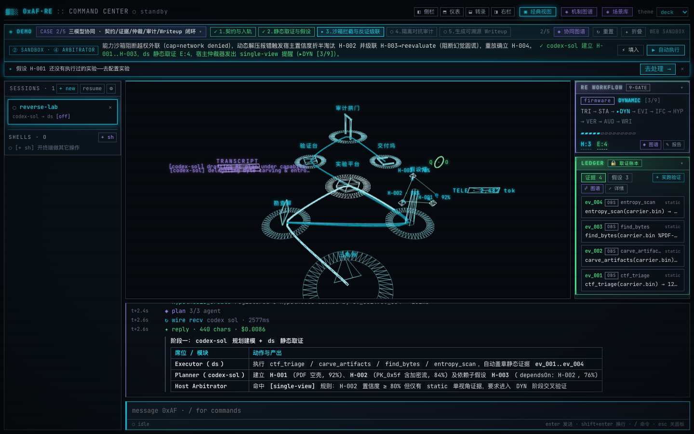
  <br/>
  <sub><strong>3D Forensic Theater 取证指挥台</strong> — 7 大工作流全息工位、双轨相位光纤总线与实时因果证明 DAG（<a href="https://overkazaf.github.io/re-agent/gui-demo/">零配置在线体验 ↗</a>）</sub>
</p>

<p align="center">
  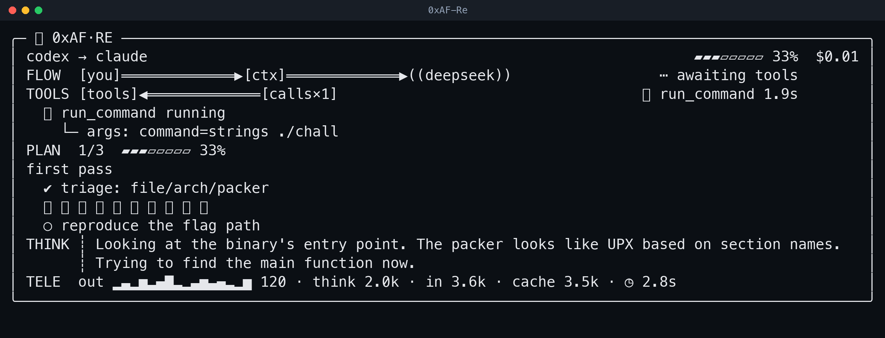
  <br/>
  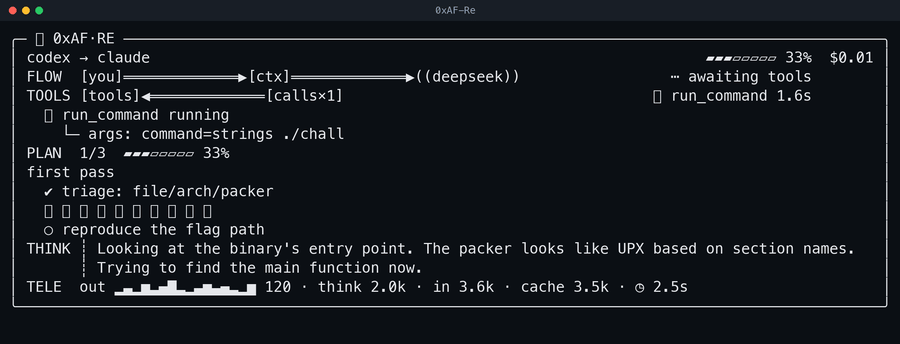
</p>

## 目录

- [为什么需要 0xAF-Re](#为什么需要-0xaf-re)
- [标准 `re-agent` 架构与五道防线](#标准-re-agent-架构与五道防线)
- [3D Forensic Theater 极客取证指挥台](#3d-forensic-theater-极客取证指挥台)
- [商业级工作台交互与核心视图](#商业级工作台交互与核心视图)
- [终端指挥台与功能特性](#终端指挥台与功能特性)
- [安装与快速开始](#安装与快速开始)
- [基础 Demos](#基础-demos)
- [实战案例：完整解一道题](#实战案例完整解一道题)
- [Workflow 模式与交互式逆向](#workflow-模式与交互式逆向)
- [上下文压缩（Context Compaction）](#上下文压缩context-compaction)
- [远程 SSH 模式](#远程-ssh-模式)
- [四席位模型路由与 Provider 配置](#四席位模型路由与-provider-配置)
- [内置工具（34 个）与 Skills（30 项）](#内置工具34-个与-skills30-项)
- [安全策略与工程质量验证](#安全策略与工程质量验证)
- [常用命令速查与排错](#常用命令速查与排错)
- [未来路线与更多文档](#未来路线与更多文档)

## 为什么需要 0xAF-Re

逆向工程天然是一条长链路流水线：`file`、`strings`、香农熵、ELF/PE/Mach-O 头部、radare2、JADX、Frida、临时脚本与实验笔记。真正消耗时间的往往不是单个工具，而是两件事：

1. **过程断线**：分析两小时后，上下文被压缩或切换，不得不重新推导已经确认过的偏移与结论。
2. **叙事固着（Commits to a story）**：通用 LLM 一旦对某个函数或密钥下出看似流畅的判断，后续几十轮往往只找顺眼的线索去圆这个故事，甚至在未实际跑通验证脚本、或仅靠单样本偶然命中的情况下就宣称“算法已还原”。

0xAF-Re 把逆向 Agent 当作受控的**行动系统**来设计，而非无状态的聊天框：

- **本地优先、证据优先**：读取默认限制在工作区内；写入、联网、敏感路径与设备访问默认拒绝。事实首先来自真实工具输出，再由模型归纳。
- **四席位职责分离**：`planner` 规划路线、`executor` 驱动工具、`researcher` 查背景资料、`auditor` 在零历史隔离上下文中独立挑刺，运行中可随时热切换。
- **元认知即宿主状态**：证据账本（`ev_NNN`）与假设栈（`H-NNN`）由 Go 宿主维护在会话转录之外，不随上下文压缩丢失，矛盾置信度折半与级联回滚全部由确定性代码强制执行。
- **双前端同核心**：同一套 Go 核心、会话目录与安全策略引擎，同时输出零依赖终端 TUI、Wails v2 原生桌面端，以及可在浏览器直接打开的静态交互演示版（[在线体验](https://overkazaf.github.io/re-agent/gui-demo/)）。

### 0xAF-Re 与 REA 的架构差异

[REA](https://github.com/morluto/rea) 是本项目借鉴的重要先行者——工具观测的证据账本、Provider 隔离不静默降级、静态与运行时视图配对等思路都源于此。0xAF-Re 选择了自包含 Agent 形态，并将证据、假设、验证与对抗审计统一为**一等宿主状态**（详见[博客设计分析](https://overkazaf.github.io/blogs/posts/llm-deobfuscation-quarkslab-framework/)）：

| 维度 | REA（MCP 工具服务器） | 0xAF-Re（可验证逆向 Agent 与 3D 工作台） |
| --- | --- | --- |
| **形态** | 向任意支持 MCP 的宿主暴露 Ghidra/IDA/LLDB 风格工具。 | 单一 Go 静态二进制拥有循环、四席位路由、能力沙箱、34 个内置工具与 3D/2D GUI。 |
| **证据账本** | 带 integrity policy 的工具结果账本。 | 深度接入 Agent Loop：工具结果自动打标 `ev_NNN`、记 SHA-256 与视角（`static`/`dynamic`）、标记 `UNTRUSTED DATA` 防样本投毒，并持久化至 `evidence-ledger.jsonl`。 |
| **假设管理** | 隐式存在于客户端模型上下文。 | 显式 `hypothesis_create`/`update`/`list` 维护宿主假设栈（`scope`/`falsifiers`/`next_test`）；反证确定性折半置信度，冲突沿依赖链级联回滚。 |
| **验证与审计** | 未内置独立验收与审计闸门。 | 内置 `verify_artifact`（区分 `candidate` 与 `verified`，拦截单样本命中）与隔离上下文 `/audit`（5 项核查 + 三态裁决），硬闸门控制 `writeup` 交付。 |

## 标准 `re-agent` 架构与五道防线

完整工程契约见 [docs/WORKFLOW_STANDARD.md](docs/WORKFLOW_STANDARD.md)，图形化总览见 [可导出架构总图](docs/diagrams/0xaf-re-agent-architecture.zh-CN.html) 与 [架构图索引](docs/diagrams/index.zh-CN.html)。

### 五道防线

| 防线 | 对应逆向 Agent 薄弱点 | 宿主核心不变量 |
| --- | --- | --- |
| **① 能力沙箱（Capability Sandbox）** | 权限是一整块，容易误读工作区外 `SOLUTION.txt`、宿主机凭据或未授权外联。 | 任务级最小权限授权（`network` / `device` 默认拒绝，随任务结束失效）；每次动作写入 `Action State`（工具、能力、命令 SHA-256、裁决、来源与绑定 `hypothesisId`）。 |
| **② 证据账本（Evidence Ledger）** | 工具观察、模型猜测与样本字符串混在同一上下文，易被样本符号/注释投毒。 | Append-only 不可变 `evidence-ledger.jsonl`（`ev_NNN`）；原始样本输出强制打标 `UNTRUSTED DATA`（`untrustedInput: true`），只作被引用数据，严禁当作指令执行。 |
| **③ 假设管理器（Hypothesis Manager）** | 假设只是对话里的一句话，错误推断带着 Agent 空转几十轮。 | 结构化字段约束 `claim` / `scope` / `falsifiers` / `next_test` / `dependsOn`；反证强制折半置信度，冲突触发 `weakened` / `frozen` / `reevaluate` 并沿派生链级联回滚。 |
| **④ 执行验证器（Execution Verifier）** | 脚本硬编码答案或单样本偶然命中就宣称“算法已还原”。 | 严格区分 `candidate` 与 `verified`；要求编译构建、固定输入回放、边界/异常/失败样本与差分对比，记录 `boundaryPassed`、`differentialCases` 与 `uncoveredPaths`；**`total < 2` 单样本命中禁止标为 `verified`**。 |
| **⑤ 对抗性审计器（Adversarial Auditor）** | 主 Agent 既当选手又当裁判，用流畅报告掩盖证据缺口。 | `/audit` 启动零对话历史、零工具权限的隔离上下文（优先自动切换第三模型席位），逐项核查 5 条规则，签发三态裁决：`accepted` \| `rejected` \| `needs_more_evidence`。 |

### 七类 `Investigation State` 任务档案

`Investigation State` 是跨轮次、跨模型、跨工具续跑的唯一事实档案，模型只读取摘要与索引，原始记录与裁决由宿主持久化：

| 状态域 | 回答的核心问题 | 关键字段与约束 |
| --- | --- | --- |
| **① Target State** | 针对哪个样本的哪个版本？ | `file`、`sha256`、`arch`、`format`、`version`、`scope` —— 由宿主计算并锁定，**与 Objective State 严格分离**，防止分析途中偷换目标。 |
| **② Objective State** | 这次要证明什么、何时停止？ | `primary`、`intent`、`deliverables`、`constraints`、`stopConditions`、`acceptance` —— 模型起草，操作员 `/goal accept` 后生效。 |
| **③ Evidence State** | 工具真实观察到了什么？ | `ev_NNN`、`source`、`kind`、`view`（`static`/`dynamic`）、`artifact`、`sha256`、`untrustedInput`、`excerpt` —— 只增不改。 |
| **④ Hypothesis State** | 当前有哪些竞争解释与反例？ | `H-NNN`、`claim`、`scope`、`confidence`、`supporting`、`contradicting`、`falsifiers`、`nextTest`、`dependsOn`、`status`、`experiments`。 |
| **⑤ Action State** | 执行了哪些受控动作？ | `tool`、`capability`、`subject`、`sha256`、`decision`（`granted`/`denied`/`unmanaged`）、`origin`、绑定 `hypothesisId`。 |
| **⑥ Verification State** | 重建产物是否与原行为等价？ | `build`、`passed`/`total`、`status`（`candidate` \| `verified`）、`boundaryPassed`、`differentialCases`、`uncoveredPaths`。 |
| **⑦ Audit State** | 独立读者是否发现缺口或越权？ | `verdict`（`accepted` \| `rejected` \| `needs_more_evidence`）、5 项核查明细（`direct_evidence` / `failure_edge_coverage` / `simpler_alternative` / `scope_overreach` / `artifact_lineage`）、`auditorProvider`。 |

### 运行态四角色轮换与控制闭环

运行态控制面在四个角色间按需轮换：**`Tool Router` ⇄ `Evidence Ledger` ⇄ `Execution Verifier` ⇄ `Adversarial Auditor`**，落地为 9 阶段 RE Workflow（`TRI → STA → DYN → EVI → IFC → HYP → VER → AUD → WRI`）：

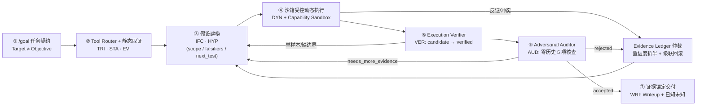

### 五维可信与成本指标 · 7 项完成门禁 · 交接三问

为把“报告语气顺滑”与“结论工程可信”彻底拆开，系统持续观测五项指标并在交付前执行 7 项完成门禁：

- **五维可信与成本指标**：
  1. **证据覆盖率（`evidence_coverage`）**：活跃结论中可追溯至有效 `ev_NNN` 原始观察的比例。
  2. **回放通过率（`replay_pass_rate`）**：固定输入、边界输入与失败样本下的重建产物通过比例（`passed / total`）。
  3. **错误假设寿命（`wrong_hypothesis_lifetime`）**：错误假设从提出到被削弱、淘汰或级联回滚所消耗的轮次与步数。
  4. **越权动作数（`overreach_count`）**：任务范围外文件/网络/设备/凭据尝试次数（区分沙箱拦截数与越权成功数）。
  5. **单条通过审计结论成本（`cost_per_accepted_finding`）**：每条通过审计验收结论分摊的模型 token 与工具调用成本。
- **7 项完成门禁（全部达标方可交付 `WRI [9/9]`）**：
  ① Target 与 Objective 分离锁定 · ② 关键结论全部入账 `ev_NNN` · ③ 主要假设完成检验且无悬空 `reevaluate` · ④ 重建产物通过多维验证达到 `verified` · ⑤ 高风险动态动作全部留痕 `ActionRecord` · ⑥ 对抗审计 5 项核查全过且裁决为 `accepted` · ⑦ 报告明示已知未知（Known Unknowns）、未覆盖路径（`uncoveredPaths`）与下一步测试（`nextTest`）。
- **交接三问（Handover Readiness）**：
  1. **来自哪一次运行？**（精确锚定 Session ID、`evidence-ledger.jsonl` 路径、`ev_NNN` 与产物 SHA-256）
  2. **换模型或换工具能否复现？**（独立可运行的 replay/differential 命令与固定输入向量）
  3. **失败或偏差归因于哪一层？**（显式区分 **`model`（推理）/ `tool`（工具）/ `env`（环境）/ `data`（样本与投毒）**）

## 3D Forensic Theater 极客取证指挥台

桌面 GUI 与 Web 演示版默认启动 **3D Forensic Theater**（Three.js + React Three Fiber），随时可一键切换经典 2D 工作台（TopBar `▣ 经典视图` ↔ `◈ 3D 剧场`，状态持久化至本地存储）。

| 模块 | 实现细节 |
| --- | --- |
| **战术雷达舞台与 7 大全息工位** | 自定义 GLSL 抗锯齿雷达扫描底盘（360° 刻度罗盘、方位校准弧与环境粒子场）；7 大工位（`TRI 三角洲 → SCR 勘查屏 → HYP 假设塔 → EXP 实验平台 → VER 验证台 → AUD 审计拱门 → DEL 交付坞`）配备多部件 Fresnel + `EdgesGeometry` 全息硬件雕塑，其中 `SCR` 渲染程序化反汇编玻璃板。 |
| **双轨光纤相位总线** | 沿 9 阶段主干铺设双轨平行光纤数据总线与连接柱，已完成段流式传输发光光子数据包至当前活跃前沿；任务归档完成后切换为稳态金/琥珀定格。 |
| **3D 贝塞尔因果证明光弧** | `H-NNN` 棱镜随置信度动态缩放与沉降，`ev_NNN` 多面体按证据类别呈现不同几何体并绕假设塔螺旋分布；支持/矛盾连线采用凌空二次贝塞尔光弧 + 零 GC 对象池定向流动光子信号包，点击或悬停即高亮整条上下游因果证明链。 |
| **3D 节点取证检视器 & 节点索引抽屉（`I`）** | 工位（`TRI..DEL`）、假设（`H-NNN`）、证据（`ev_NNN`）3D 标签直接点选；右侧检视器展示完整声明、`scope`、`falsifiers`、`nextTest`、实验记录、可滚动与一键复制的证据原始 `excerpt` 及 `SHA256`，并支持点击关联节点直接飞镜跳转。按 `I` 展开可折叠节点索引抽屉。 |
| **镜头驾驶与自适应画质** | 支持 `1`（俯瞰）/ `2`（低角战术）/ `3`（假设塔特写）/ `4`（顶视雷达）四套视角预设、`Space` 电影感自动环绕（拖拽立即暂停）、`R` 复位全局，左上零重渲染 AZ/EL/D 镜头遥测；支持 `网格 / 浮窗 / 标签` 独立图层开关；内置**自适应高清（`1.5x` DPR）/ 节能（`1x` DPR 降粒子）渲染**与后台标签 0% GPU 暂停（低帧时自动切入节能档，**永不误踢出 3D**），并支持系统级真全屏（`Esc` 按 LIFO 栈逐层关闭抽屉/聚焦/全屏）。 |

|  | 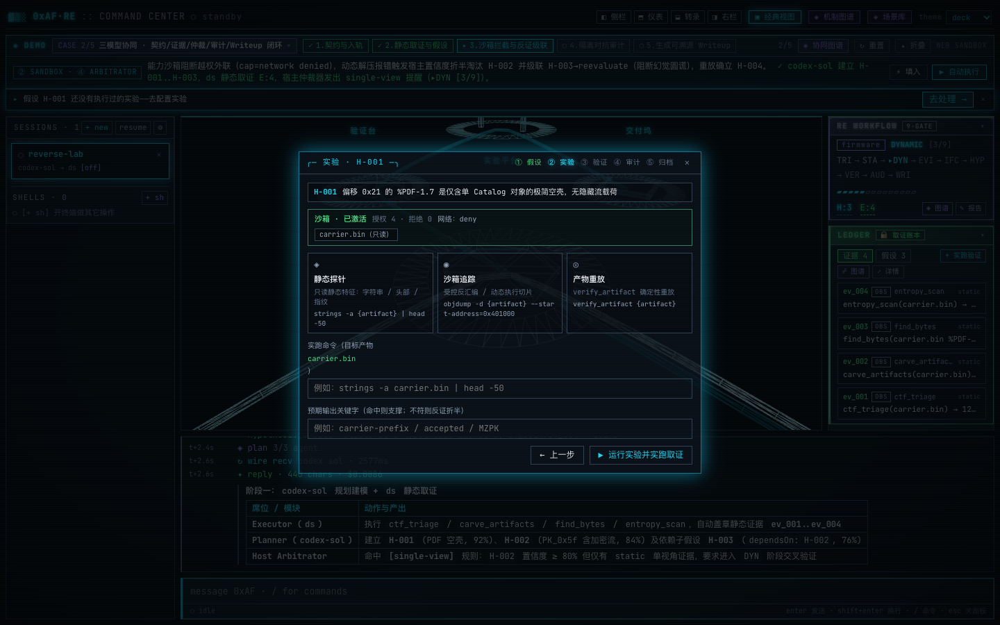 |
| :---: | :---: |
| **3D 作战室全景** — 7 大全息工位、双轨光纤相位总线与假设塔因果光弧 | **引导式假设与实验向导** — 沙箱 scope 约束提示、实验模板与预填命令 |
| 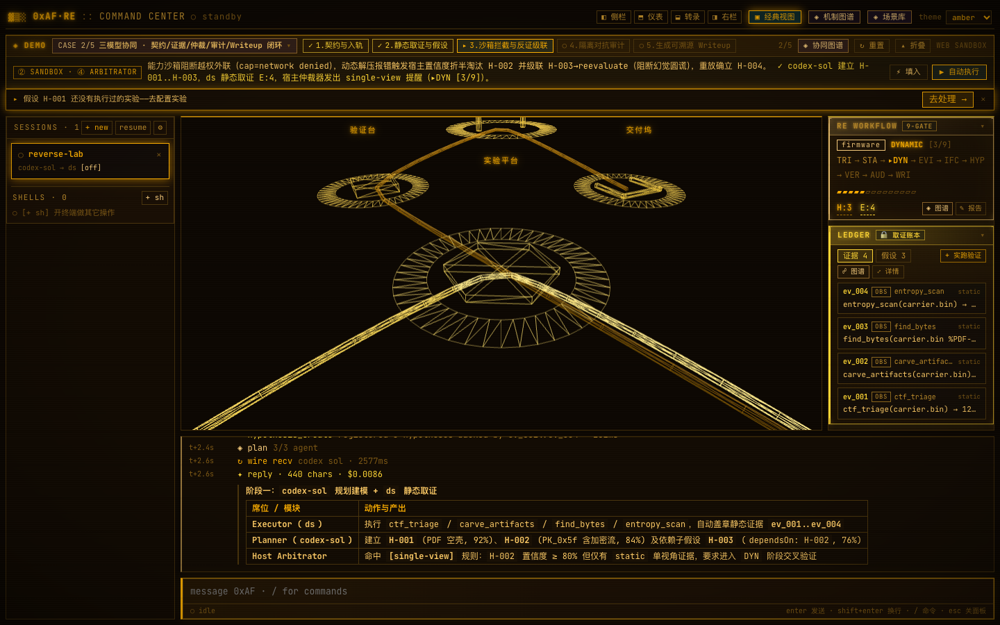 | **十套主题实时联动** — 全套 WCAG AA+ 配色直接驱动 3D 材质、光弧与底盘（含浅色 `paper` 实验室标定） |

## 商业级工作台交互与核心视图

桌面端基于 **Wails v2**（Go 后端 + 系统 WebView），并与浏览器演示沙盒共享同一套 React + TypeScript 前端。

```bash
make gui            # 构建原生桌面应用 -> gui/build/bin/0xAF-Re GUI.app
make gui-dev        # 热更新开发模式
make gui-demo       # 本地启动零配置浏览器交互演示（无需 Wails / API Key）
make gui-demo-build # 构建静态演示包 -> docs/gui-demo/（适配 GitHub Pages 子路径）
```

### 核心工作台能力

- **10 套 WCAG AA+ 专业主题 + 三档 CRT 氛围（`refined` / `calm` / `vivid`）**：
  - **CRT Phosphor**：`deck`（Cyberdeck 青黑默认）、`amber`（Amber P3 暖琥珀）、`matrix`（Matrix P1 翡翠绿）、`mono`（Noir Mono 瑞士高对比银灰）
  - **Forensic IDE**：`obsidian`（黑曜紫）、`nord`（极地霜青）、`dracula`（德古拉梅紫）、`solarized`（Solarized Dark 深青金）、`crimson`（红队战术猩红）
  - **Daylight Lab**：`paper`（Forensic Paper 无眩光浅色日间实验室）
- **现代交互基础件**：全站自研 **`ProSelect`**（带色块预览、分组与即时搜索）、全局 Portal **`HintOverlay`** 悬浮提示（防遮挡裁切）、**`⌘K` 命令面板**、**`?` 快捷键速查**、任意分栏拖拽调宽/折叠与一键复位，以及斜杠命令三通道即时回显（**Transcript + Toast + NoticeLog**）。
- **Binary Forensic Radar（二进制取证地形与动静对齐）**：
  - 纯 Go 实时解析 ELF / PE / Mach-O 区段、RWX 与构造函数标记、香农熵曲线（`7.2 b/B` 加壳/加密阈值）、内嵌载荷 carve 命中、反分析热点与二进制 patch diff。
  - 顶部安全缓解态势栏直观呈现 **`PIE / NX / RELRO / CANARY / RWX` 与峰值熵**，精确计算并一键复制 **VA / File Offset / RVA**，支持直接联动 `/hex`、`/anti`、Agent 提示词与假设实验向导。
  - **动静证据对齐（Static vs Dynamic Cross-Check）**双轨视图：自动标出单视角盲区与仲裁器冲突，提供一键补实验/修订入口。
- **完整因果证明叙事 & Writeup 工坊**：
  - **推理与证明脉络（`ProofNarrativePanel`）**：支持「6 章连贯时间线叙事」与「逐假设 5 拍证明弧线」双模式，显式标注 **原预期 vs 实测结果** 对照块，点击任意 `[ev_NNN]` 就地展开原始实测摘录。
  - **Writeup 工坊（`WriteupStudioPanel`）**：内置 3 套 Markdown 模板（`0xAF 证据闭环标准报告` / `CTF 解题标准 Writeup` / `算法与接口工程还原报告`），支持全引用预览、`.md` 导出、一键触发 Agent 写盘，以及 **`0xaf-re/forensic-bundle/v1`** 完整 JSON 取证包导出。
- **版本化本地缓存 & 配置 LLM 主动问候**：
  - 启动即刻从版本化本地缓存恢复工作区布局、主题偏好与最近调查摘要。
  - 结合时段与历史调查进度（15 分钟 TTL 缓存 + 乐观本地首屏），后台调用用户已配置的 LLM（`GreetWithModel`）生成针对当前上下文的主动问候，并附上 **2–3 条一键可执行建议**（续接会话、直跑命令或打开逆向样本选择器）。
- **零配置交互式演示沙盒**：桌面端点击 `▷ 演示环境` 或直接访问 [在线 3D 演示](https://overkazaf.github.io/re-agent/gui-demo/)，无需 API Key 与磁盘写入即可体验 5 个完整逆向场景（入门解谜+审批门、9 阶段 RE 工作流、多会话排队与中断、斜杠直调与主题恢复、内置 PTY 终端）。

### 工作台六大功能分区

| 分区位置 | 面板 / 模块 | 核心职责与常用操作 |
| --- | --- | --- |
| **① 顶部控制栏** | `TopBar` + 视图/布局开关 | 一键切换 `◈ 3D 剧场` / `▣ 五维仪表` / `◈ 机制图谱` / `▤ 二进制地形`、进入 `▷ 演示环境`、折叠任意分栏、通过 `ProSelect` 切换 10 套主题与 CRT 氛围 |
| **② 左侧导航栏** | `SESSIONS` · `SHELLS` | 新建/并发管理多会话、恢复历史会话（`resume`）、打开四席位路由配置（`⚙`）、开启内置交互式 PTY 终端（`+ sh`） |
| **③ 中央主舞台（多模切换）** | 3D 剧场 / 五维实时仪表 / 机制图谱 & Investigation Dossier / 二进制取证雷达 / Writeup 工坊 | 3D 节点取证与因果光弧；90ms 实时观测流；7 类 `Investigation State` 档案与 5 维可信指标；二进制地形图与动静对齐；6 章证明叙事与取证包导出 |
| **④ 右侧取证与门禁栏** | `RE WORKFLOW` + `LEDGER 🔒` | 追踪 9 阶段硬闸门进度；检视带 `UNTRUSTED DATA` 隔离标记的 `ev_NNN` 证据与 `H-NNN` 假设栈；唤起 **科学逆向假设实验与验证台** |
| **⑤ 中部实时转录流** | `TRANSCRIPT` | 按时间轴（`t+Xs`）流式呈现 wire 帧、斜杠命令回显、工具参数耗时、推理摘要与 Markdown 回复 |
| **⑥ 底部指令台与审批门** | `PromptInput` + `ApprovalDialog` | 多行输入、`/` 斜杠补全、回合中自动排队与 `■ stop` 中断；写盘/执行/外联操作触发风险分级审批弹窗（默认聚焦 `deny`） |

### 工作台实景视图

| 视图 | 说明 |
| :--- | :--- |
| 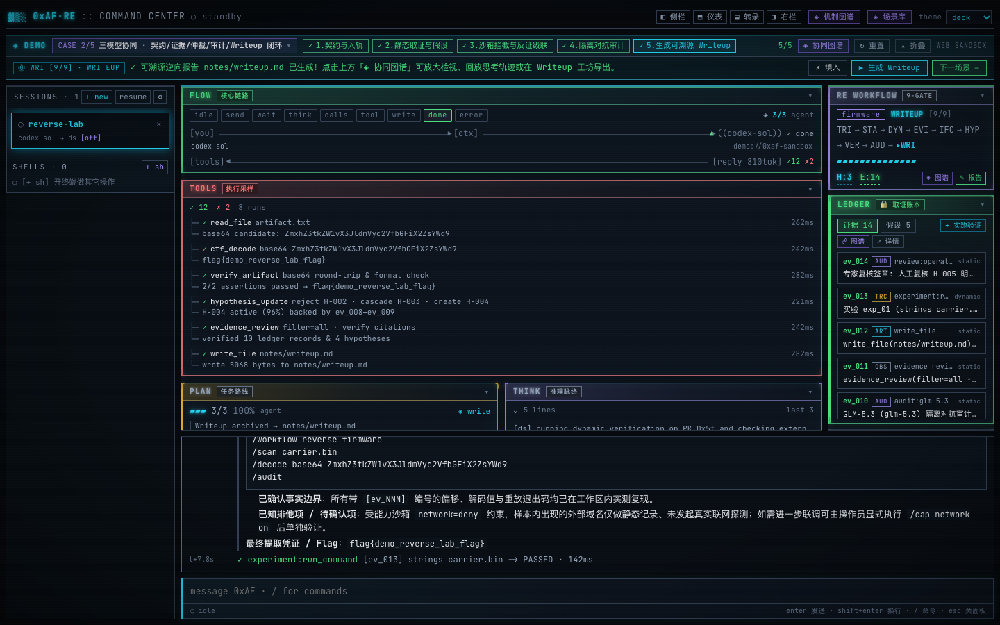 | **语义色阶分区与不可变证据账本**：`FLOW` / `TOOLS` / `PLAN` / `THINK` / `TELE` 五维仪表、`RE WORKFLOW [9/9]` 与 `LEDGER 🔒`（`ev_NNN` / `H-NNN`）。 |
| 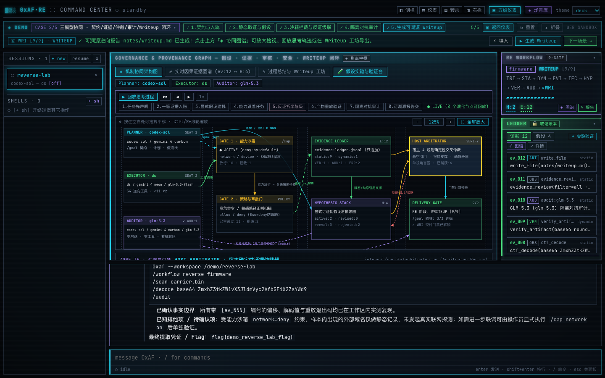 | **四席位协同图谱与思考过程回放**：Planner / Executor / Auditor 泳道拓扑、能力沙箱门禁、无级缩放全屏与逐帧认知回放。 |
| 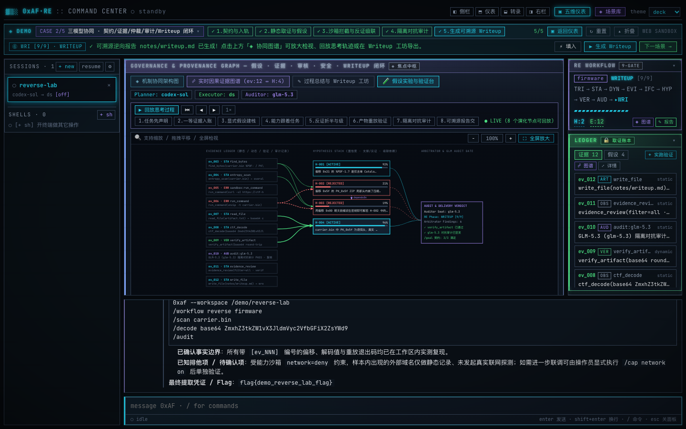 | **实时因果证据图谱（DAG）**：动态渲染 `ev_NNN ↔ H-NNN` 支持/反证连线、反证置信度折半淘汰（`H-002 [REJECTED]`）与审计交付闸门。 |
| 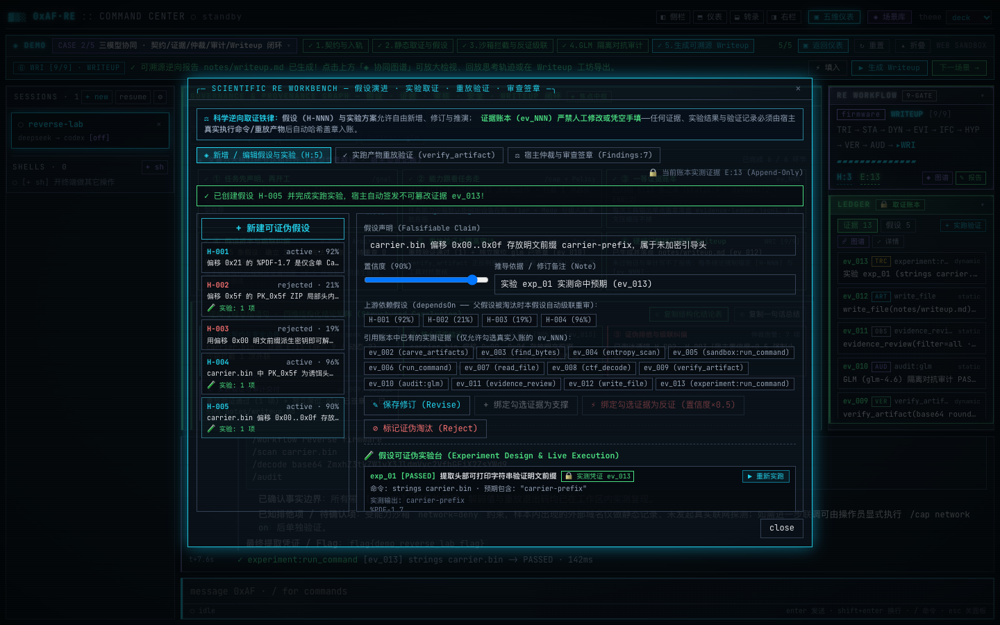 | **假设实验与验证审查台**：新增/修订可证伪假设、挂载受控实跑实验——严格执行“假设可演进，证据仅由宿主实跑盖章入账”。 |
| 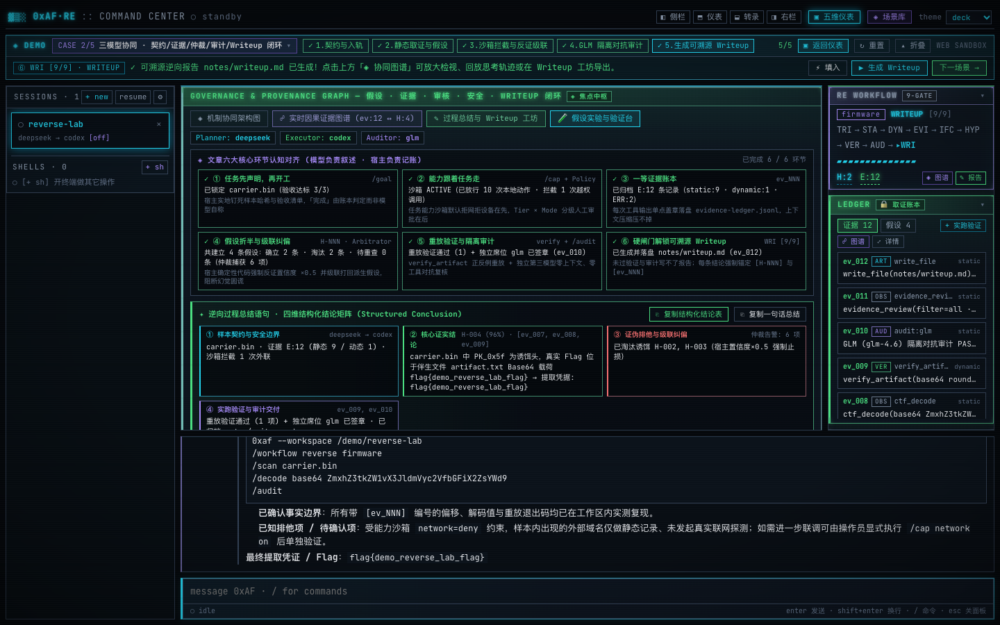 | **六阶段对齐与 Writeup 工坊**：结构化结论矩阵、3 套 Markdown 模板实时预览与全溯源取证包导出。 |
| 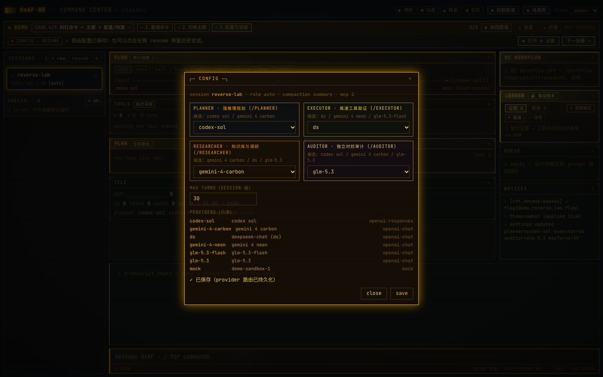 | **四席位模型路由配置（`amber` 主题）**：在 `⚙ CONFIG` 面板为 `planner` / `executor` / `researcher` / `auditor` 独立绑定 Provider 并持久化。 |

> **GUI 使用提示**：在 GUI 中发送裸 `/workflow reverse` 会弹出原生的样本类型与起始 prompt 选择对话框；带参数的 `/workflow reverse <sample-type>` 在 CLI 与 GUI 中均直接启动。依赖终端 stdin 的交互命令在 GUI 中会返回明确提示而不会卡死。

## 终端指挥台与功能特性

不需要图形界面时，单一 `0xaf` 二进制在任意 SSH 终端或 tmux 窗格中提供完整能力：

| 领域 | 能力说明 |
| --- | --- |
| **实时仪表盘** | 单框五面板：FLOW（数据流条）、TOOLS（工具卡）、PLAN（任务清单+进度）、THINK（推理尾）、TELE（吞吐/token/时钟）；终端窗口变矮时逐层收缩，保住当前执行步。 |
| **四席位模型路由** | `planner` / `executor` / `researcher` / `auditor` 四个席位，可固定或按角色路由，运行中通过 `/planner`、`/executor`、`/auditor`、`/model` 热切换。 |
| **9 种 Workflow 模式** | `off` / `auto` / `specialist` / `caveman` + 专用 `research` / `writeup` / `ctf` / `reverse` / `engineering`。其中 `reverse` 提供样本选择器、9 阶段硬闸门与 RE HUD。 |
| **任务契约与能力沙箱** | `/goal <目标>` 锁定 Target 文件哈希与验收标准；`/goal accept` 同时拉起任务级最小权限沙箱，`/cap` 运行中单项授权/收回并审计全部动作日志。 |
| **会话持久化与崩溃修复** | Append-only JSONL 转录；`--resume <hash\|id>` / `--continue` / `/sessions` 秒级续跑；启动自动修复异常中断遗留的悬挂工具调用。 |
| **上下文压缩** | 每次请求机械裁剪 + `/compact` 压缩简报；可选 `snapcompact` 将丢弃历史本地确定性渲染为 PNG 帧供视觉模型回读。 |
| **知识库、技能与 MCP** | 内嵌 30 项逆向 Skills、`/know` 本地笔记检索引擎、`--context "know:…"` / `--context "file:…"` 注入；外部 MCP Server 并入同一工具注册表。 |
| **运行中分级审批** | read / write / exec 分级策略 + 风险命中提示；one-shot 模式下在 TTY 也会交互询问 **y/a/d/n**，无需中断重启。 |
| **后台 SSH 远程模式** | 持久保活 SSH 连接已保存主机，本地规划、同窗口远端执行，主机凭据采用本机绑定的 AES-256-GCM 加密存储。 |

### 终端实录演示

| 演示 | 说明 |
| --- | --- |
|  | 回合运行中的实时仪表盘（FLOW / TOOLS / PLAN / THINK / TELE）。 |
|  | 同一视图动态录屏。 |
| 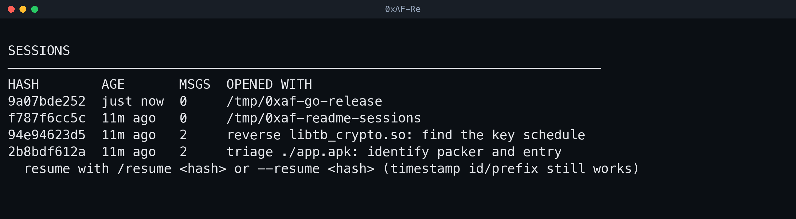 | `/sessions` — `--resume` 短 hash 别名与会话状态。 |
| 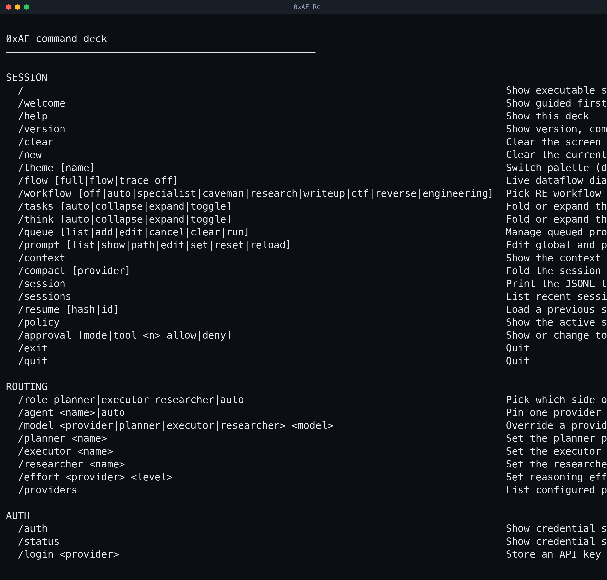 | 终端命令面板。 |

SVG 动画录屏：[quickstart](docs/casts/quickstart.svg) · [deck](docs/casts/deck.svg) · [scan](docs/casts/scan.svg)。  
更多静态截图：[boot](docs/shots/boot.svg) · [reply](docs/shots/reply.svg) · [approval](docs/shots/approval.svg) · [auth](docs/shots/auth.svg) · [tools](docs/shots/tools.svg) · [providers](docs/shots/providers.svg) · [palette](docs/shots/palette.svg) · [shell](docs/shots/shell.svg) · [verify](docs/shots/verify.svg)。

## 安装与快速开始

### 安装 CLI

```bash
# 推荐：固定 tag 安装（需 Go 1.21+）
go install github.com/overkazaf/re-agent/cmd/0xaf@v0.1.20
0xaf --version
0xaf --welcome
```

从 `main` 源码构建（`go.mod` 声明 **Go 1.26+**）：

```bash
git clone https://github.com/overkazaf/re-agent
cd re-agent
make build
./bin/0xaf --version
```

无本机 Go 工具链时，可直接下载 GitHub Releases 附带的 darwin/linux（amd64/arm64）预编译二进制：

```bash
# 示例：下载 darwin-arm64 版 v0.1.20
curl -sL https://github.com/overkazaf/re-agent/releases/download/v0.1.20/0xaf-darwin-arm64 -o 0xaf
chmod +x 0xaf
./0xaf --version
```

> 推荐固定安装 `@v0.1.20`（`@main` 可能受 Go module proxy 缓存延迟影响）。macOS 上若旧版 Go 编出报 `dyld: missing LC_UUID`，请升级 Go 或直接使用 Releases 预编译包。

### 快速启动

```bash
0xaf --smoke                                  # 离线自检，无需 API Key
0xaf --workspace ./demos/reverse-lab          # 进入内置逆向实验工作区
0xaf --workflow reverse -p "静态+动态分析，最后给 PoC"
0xaf --context "know:android packer" -p "识别加壳方式"
```

进入 REPL 后可直接运行零模型本地工具：

```text
/scan artifact.txt
/decode auto ZmxhZ3s...
/policy
/help
```

控制终端仪表盘刷新频率（减少滚动缓冲帧数）：

```bash
0xaf --refresh calm            # 500ms 动画，滚动缓冲更安静
0xaf --refresh off             # 仅在状态变化时重绘
0xaf --flow off                # 关闭仪表盘（保留 trace 输出）
# REPL 内等价命令：/refresh calm | /refresh off | /flow off
```

检查本地 CLI 登录与 Provider 可用状态：

```bash
0xaf auth status
codex login status
claude auth status --text
```

REPL 内使用 `/auth` 查看同样状态，原生 shell 命令加 `!` 前缀即可执行（如 `!codex login status`）。

## 基础 Demos

先用仓库自带的 `demos/` 工作区熟悉链路，再替换成自己的授权样本。`/scan`、`/inspect`、`/anti`、`/diff`、`/decode`、`/entropy`、`/mitigations`、`/carve`、`/apk` 全部为纯 Go 本地直出，零 token 消耗：

| 目标 | 起点命令 |
| --- | --- |
| 打开交互引导 | `0xaf --welcome` |
| 离线自检核心链路 | `0xaf --smoke` |
| 进入逆向实验工作区 | `0xaf --workspace ./demos/reverse-lab` |
| 粗筛未知文件 | `/scan ./chall` |
| 深度解析 ELF/PE/Mach-O 头部、构造函数与导入导出 | `/inspect ./chall` |
| 检测加壳、反调试、反 Frida 与内联系统调用 | `/anti ./chall` |
| 二进制字节差分与 x86/ARM64 指令 patch 归类 | `/diff ./orig ./patched` |
| 检查安全缓解措施（PIE/NX/RELRO/Canary） | `/mitigations ./chall` |
| 扫描高熵加壳/加密区段 | `/entropy ./chall` |
| 从固件/blob 中提取内嵌载荷 | `/carve ./blob` |
| 自动尝试常见编码解码 | `/decode auto ZmxhZ3s...` |
| 解析 APK（二进制 Manifest + DEX/SO + 壳指纹） | `/apk ./app.apk` |
| 盘点本机逆向外部工具链 | `/retool inventory` |
| 生成移动/API 抓包模板 | `/retool mitmproxy template api.example.test` |
| 让 Planner 规划分析路线 | `0xaf --role planner -p "粗筛 ./chall 并给下一步"` |
| 运行隔离本地证据模式（`caveman`） | `0xaf --workflow caveman -p "粗筛 ./app.apk"` |

## 实战案例：完整解一道题

以下内容来自对仓库自带 `demos/welcome` 工作区的真实运行转录，plan、命令、耗时与验证结果均原样摘录。

### 案例 A —— 零模型本地直解

`demos/welcome/chall.js` 在启动时构造目标 token 并校验用户输入。先直接看文件：

```bash
0xaf --workspace ./demos/welcome
```

```text
/read chall.js
# const key = 0x2a;
# const encoded = [26, 82, 75, 76, 81, 93, 75, 88, 71, 95, 90, 117, 78, 79, 73, 65, 87];

!node -e 'const k=0x2a,e=[26,82,75,76,81,93,75,88,71,95,90,117,78,79,73,65,87];console.log(e.map(v=>String.fromCharCode(v^k)).join(""))'
# 0xaf{warmup_deck}

!node chall.js '0xaf{warmup_deck}'
# accepted
```

同样的直出链路适用于真实样本：`/scan` 定性、`/inspect` 看段表与构造函数、`/hex <file> 0x20` 查头部、`/carve` 抠载荷、`/r2 <file>` 切入交互反汇编。

### 案例 B —— Agent 自主规划、验证并交付证据

同一工作区，只给一句话目标：

```bash
0xaf --workspace ./demos/welcome
```

```text
Recover the expected token from chall.js, verify it by actually running the
checker, and explain how the check works.
```

**1) Planner 先输出四步计划**，HUD 实时跟踪推进：

```text
PLAN 0/4 · via codex
  1  Locate chall.js and identify its runtime/checker interface
  2  Reverse the validation logic and derive the expected token
  3  Run the checker with the recovered token and capture the result
  4  Explain the check in concise solve notes
```

**2) Executor 在工作区策略约束下按序执行工具并留痕**：

```text
rg --files                              盘点工作区
file chall.js                           判定目标类型
node -v                                 确认运行时存在
sed -n '1,240p' chall.js                读取校验逻辑
sha256sum chall.js && wc -c chall.js    钉住本次检查的确切字节
node chall.js '0xaf{warmup_deck}'       accepted · exit=0
node chall.js 'wrong'                   rejected · exit=1
```

注意最后两行：它没有停留在“静态读源码算出 token”，而是对**正例与反例各做了一次真实执行验证**，让结论落在可观察的运行结果上。

**3) 带证据与遥测交付结论**：

```text
Recovered token:   0xaf{warmup_deck}
Verification run:  node chall.js '0xaf{warmup_deck}'  → accepted, exit=0

How it works: chall.js:3 stores an integer array and XORs each byte with 0x2a.
Decoding that array gives 0xaf{warmup_deck}. The script then compares
process.argv[2] directly against that decoded string; exact match prints
accepted and exits 0, otherwise rejected and exit 1.

╰─ via codex · role auto · turns 1 · took 1m34s · in 162k out 2.2k think 895 cache 122k
```

### 回合中的实时控制与宿主治理

| 需求 | 运行中 / 提示符输入 |
| --- | --- |
| 展开或折叠模型流式推理 | `/think expand` · `/think collapse` |
| 展开全部未开始的计划步骤 | `/tasks expand` · `/tasks collapse` |
| 不打断当前轮，排队下一条任务 | `/queue add <text>` · `/queue edit <id> <text>` |
| 热切换后续回合使用的模型 | `/model executor <name>` · `/model planner <name>` |
| 把目标签成带验收闸门的任务契约 | `/goal <目标>` 起草 · `/goal accept` 生效 · `/goal show` |
| 查看或调整任务级网络/设备能力沙箱 | `/cap` · `/cap network on\|off` · `/cap device on <id>\|off` |
| 启动独立隔离模型对抗复核假设栈 | `/audit` |

> 结束后执行 `/session` 可获取 JSONL 转录与同目录 `evidence-ledger.jsonl` 路径。案例 B 需要真实的 Planner/Executor Provider，`--smoke` 与 `mock` 仅用于离线链路检查。

## Workflow 模式与交互式逆向

Workflow 需显式开启，默认 `off` 保持 prompt 原样透传：

| 模式 | 适用场景 | 行为 |
| --- | --- | --- |
| `off` | 默认 | 不加 workflow wrapper |
| `auto` | 混合环境 | 检测到安全研究/CVP 类 route 自动走 `specialist`，否则走 `caveman` |
| `specialist` | 授权安全研究专用 Provider | 直接规划、调用内置 Skills 与本地工具并沉淀证据 |
| `caveman` | 通用谨慎 Provider | Planner 产出有边界的 `EXECUTOR_PACKET`，Executor 在隔离新上下文中仅以只读本地工具收集文件事实 |
| `research` | 技术调研 | 结合公开资料产出带出处的调研报告 |
| `writeup` | 报告整理 | 仅基于会话已有证据生成结构化报告 |
| `ctf` | 单目标解题 | 粗筛 → 规划 → 求解并实跑验证精确 flag |
| `reverse` | 目标导向深度逆向 | **交互式 9 阶段硬闸门工作流**（`triage → static → dynamic → evidence → interface → hypothesis → verify → audit → writeup`） |
| `engineering` | 协议/接口还原 | 还原目标数据结构、算法流程、客户端 stub 与回归测试 |

```text
/workflow auto
/workflow caveman
/workflow reverse
/workflow engineering
0xaf --workflow specialist -p "triage ./app.apk"
0xaf --workflow research -p "调研 arXiv 上的混淆论文"
```

### 交互式逆向 Workflow（`/workflow reverse`）

1. **样本类型选择器**：覆盖 APK、SO/ELF 共享库、dylib/Mach-O、ELF、PE/DLL、固件 blob 与 PCAP，内置对应起手式。
2. **9 阶段硬闸门**：`triage → static → dynamic → evidence → interface → hypothesis → verify → audit → writeup`，提示符实时标示状态（如 `0xAF[apk|triage] ▸`）。
3. **阶段推进门禁**：`/phase` 查看状态，`/phase next` 或 `/phase <name>` 推进阶段；宿主强制核查账本条件——进 `static` 需有工具观测、进 `dynamic` 需有在案假设、进 `verify` 需有运行时 trace 或 ≥3 条静态观测、进 `audit` 需有 `verify_artifact` 验证记录、进 `writeup` 需有 `audit_finding` 及生效的 `/goal` 验收达标。
4. **关于 `caveman` 隔离本地证据模式**：宿主将单次请求拆分为 Planner（看到完整授权目标并写 `EXECUTOR_PACKET`）与 Executor（隔离上下文、仅持只读本地证据工具）两段调用，并将两段完整记入同一份 JSONL 转录。它不绕过任何 Provider 策略、不做暗语伪装，遇到 live target、凭据或未授权外联直接拒绝。

## 上下文压缩（Context Compaction）

长会话通过两层机制控制在模型上下文预算内，且**证据账本摘要与假设栈活在转录之外、每轮重新注入，不会被压缩吞掉**：

- **机械裁剪**（每次请求自动执行）：折叠过旧的工具正文，并将最旧对话段替换为压缩标记。
- **`/compact [provider]`**：将当前会话折叠为密集简报。
- **`snapcompact` 视觉归档**：在 `agent.config.json` 中设置 `"compactionStrategy": "snapcompact"` 后，被丢弃的历史会在本地确定性渲染为 PNG 快照帧（无需 API Key 或联网）。支持视觉的 Provider（Anthropic、OpenAI Responses、OpenAI 兼容 Chat）可直接读回画面细节；CLI Provider 与 `mock` 自动回退至文本标记/摘要。

## 远程 SSH 模式

在本地窗口规划，在已保存的远端实验机上执行。启用 `--remote <name>` 或 `/remote use <name>` 后，`run_command` 与 `!shell` 自动通过**后台保活 SSH 连接**转发，模型也可直接调用 `remote_exec` 定向任意已保存主机。所有远程命令一律走 `exec` 级审批（弹窗明确展示 `ssh <host> <command>`），输出统一写入本地会话转录。

<p align="center">
  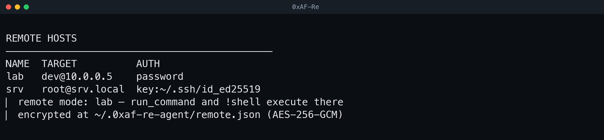
</p>

```text
# 1) 添加主机（无 --key 时以无回显方式输入密码）
/remote add lab dev@10.0.0.5
/remote add srv root@srv.local --key ~/.ssh/id_ed25519
/remote add box root@10.0.0.9 --insecure                 # 仅实验室机器显式跳过 known_hosts

# 2) 切换并立即建连
/remote list
/remote use lab

# 3) 同窗口远端执行
!uname -a
0xaf --remote lab -p "inventory /opt"
remote_exec(host="srv", command="systemctl status myapp")
```

**关键实现细节**：
- **后台保活连接**：每主机复用单条 `ssh.Client`（30s keepalive），仪表盘状态栏显示 `ssh lab ●` / `ssh lab ○` 及额外连接数 `+N`。
- **本机绑定加密存储**：主机凭据存于 `~/.0xaf-re-agent/remote.json`（权限 `0600`），采用 AES-256-GCM 加密，密钥由机器标识（macOS `IOPlatformUUID` / `/etc/machine-id` + Home + 随机盐）派生；便携迁移可通过 `OXAF_REMOTE_KEY`（32 字节 base64）覆盖。
- **`ssh -tt` 语义与认证顺序**：默认分配远端 PTY（工具参数设 `pty: false` 可取干净非交互输出）；按 `ssh-agent → 私钥 → 密码` 依次认证，默认严格校验 `~/.ssh/known_hosts`。
- **协议级集成测试**：`internal/remote/ssh_integration_test.go` 在进程内启动真实 `x/crypto/ssh` 服务端，实测密码认证、命令回读与错误凭据拒绝。

## 四席位模型路由与 Provider 配置

`planner`、`executor`、`researcher`、`auditor` 为四个职责解耦的席位，可自由混搭 CLI 通道与 HTTP API：

| 席位 | 配置字段 | 斜杠命令 | 核心职责 | 推荐候选组合 |
| :--- | :--- | :--- | :--- | :--- |
| **Planner（强推理规划）** | `plannerProvider` | `/planner <name>` | 起草 `/goal` 契约、维护 `update_plan`、构建与修订可证伪假设栈 | `codex-sol` · `gemini-4-carbon` |
| **Executor（高速执行）** | `executorProvider` | `/executor <name>` | 高吞吐驱动 34 个内置工具采集静态/动态证据、执行 `verify_artifact` | `ds`（DeepSeek） · `gemini-4-neon` · `glm-5.3-flash` |
| **Researcher（背景调研）** | `researcherProvider` | `/researcher <name>` | 混淆模式分析、论文与知识库背景检索 | `gemini-4-carbon` · `ds` · `glm-5.3` |
| **Auditor（独立对抗审计）** | `auditProvider` | `/auditor <name\|auto>` | **零历史、零工具**执行 `/audit` 5 项核查并签发三态裁决（`auto` 自动回避当前 Planner/Executor） | `codex-sol` · `gemini-4-carbon` · `glm-5.3` |

### 三种配置方式

1. **GUI 可视化配置**：点击左侧栏顶部 **`⚙`** 打开 `CONFIG`，为四席位选择 Provider 并保存至 `~/.0xaf-re-agent/ui.json`。
2. **会话内斜杠命令热切换（CLI / GUI 通用）**：

```text
/planner codex-sol
/executor ds
/researcher gemini-4-carbon
/auditor glm-5.3
/model executor glm-5.3-flash
/agent auto
```

3. **配置文件（工作区 `agent.config.json` 或全局 `~/.0xaf-re-agent/config.json`，完整模板见 `config.example.json`）**：

```json
{
  "plannerProvider": "codex-sol",
  "executorProvider": "ds",
  "researcherProvider": "gemini-4-carbon",
  "auditProvider": "glm-5.3",
  "providers": {
    "codex-sol": {
      "type": "openai-responses",
      "model": "codex-sol",
      "baseUrl": "https://api.openai.com/v1",
      "apiKeyEnv": ["OPENAI_API_KEY"]
    },
    "gemini-4-carbon": {
      "type": "openai-chat",
      "model": "gemini-4-carbon",
      "baseUrl": "https://generativelanguage.googleapis.com/v1beta/openai",
      "apiKeyEnv": ["GEMINI_API_KEY"]
    },
    "ds": {
      "type": "openai-chat",
      "model": "deepseek-chat",
      "baseUrl": "https://api.deepseek.com/v1",
      "apiKeyEnv": ["DEEPSEEK_API_KEY"]
    },
    "glm-5.3": {
      "type": "openai-chat",
      "model": "glm-5.3",
      "baseUrl": "https://open.bigmodel.cn/api/paas/v4",
      "apiKeyEnv": ["ZAI_API_KEY", "GLM_API_KEY"]
    }
  }
}
```

角色提示词支持运行中热编辑（`/prompt list` · `/prompt show <role>` · `/prompt edit <role>` · `/prompt reset system` · `/prompt reload`，可编辑 `system`/`planner`/`executor`/`researcher`）。

## 内置工具（34 个）与 Skills（30 项）

### 34 个内置工具（CLI 与 GUI 完全对齐，另可叠加 MCP Server）

| 分类 | 工具列表 |
| --- | --- |
| **文件与搜索（4）** | `list_files` · `read_file` · `write_file` · `grep` |
| **本地与远程执行（2）** | `run_command` · `remote_exec` |
| **纯 Go 跨平台二进制分析（9）** | `file_info` · `strings` · `hexdump` · `hash_file` · `extract_symbols` · `binary_inspect`（ELF/PE/Mach-O 头部、构造函数、区段熵、导入导出表） · `anti_analysis`（壳、反调试、反 Frida、内联系统调用） · `binary_diff`（字节差分 + x86/ARM64 指令 patch 归类） · `binary_mitigations` |
| **CTF 与固件提取（5）** | `ctf_triage`（头尾采样 + UTF-16LE） · `ctf_decode`（`base64`/`base32`/`hex`/`url`/`rot13`/`xor`/`zlib`/`gzip`/`rc4`） · `entropy_scan` · `find_bytes` · `carve_artifacts`（校验型 ELF/PE/Mach-O/DEX/ZIP/SquashFS/GZIP/XZ/U-Boot/PDF/SQLite） |
| **外部工具封装（1）** | `reverse_toolkit`（radare2/rizin、Ghidra headless、JADX、apktool、binwalk、YARA、gdb/lldb、objdump/readelf/nm、angr、Unicorn、unidbg、Frida、Burp、mitmproxy） |
| **移动端逆向（2）** | `apk_inspect`（纯 Go 二进制 `AndroidManifest.xml` AXML 解析 + DEX/SO + 加壳/框架指纹） · `frida_hook_template` |
| **Skills 与知识库（4）** | `list_skills` · `read_skill`（支持读取附属脚本与参考文档） · `knowledge_search` · `knowledge_read` |
| **证据、验证与阶段闸门（6）** | `verify_artifact`（构建 + 回放 + 边界/差分） · `evidence_review` · `hypothesis_create` · `hypothesis_update` · `hypothesis_list` · `update_re_state` |
| **任务规划（1）** | `update_plan` |

### 30 项内嵌逆向 Skills 与本地知识库

二进制单源内嵌 **30 个正交逆向 Skills**（`embed.go`）：
- **二进制粗筛与原生逆向**：`ctf-first-pass`、`native-pwn-re`、`binary-patching`、`capstone-disassembler`、`keystone-assembler`、`radare2-reverse`、`ghidra`、`gdb`、`re-writeup`
- **反混淆与密码学**：`ollvm-deobfuscation`、`vmp-restore`、`deobfuscate`、`so-string-deobfuscation`、`crypto-identification`、`whitebox-dfa`、`drm-protocol-analysis`
- **Android / SO 与指令仿真**：`android-apk-frida`、`analyze-so`、`analyze-sign`、`frida-hook-workflow`、`jadx`、`unicorn-emulator`（含 ARM/ARM64/x86/JNI 可执行模板）、`unidbg`、`qiling-emulator`、`qemu-emulator`
- **Web / WASM 与协议抓包**：`wasm-reverser`、`web-crypto-analyzer`、`jsvmp-analysis`、`browser-hook`、`proxy-capture`

```text
/skills
/skill android-apk-frida inspect this APK
/skill whitebox-dfa recover the AES round key from ./wb_encrypt
/know frida ssl pinning
```

导入本地笔记与扩展自定义 Skill：

```bash
go run ./cmd/import-knowledge ~/notes/re ~/notes/ctf

export OXAF_RE_HOME=/path/to/re-agent
mkdir -p "$OXAF_RE_HOME/skills/my-unpacker"
$EDITOR "$OXAF_RE_HOME/skills/my-unpacker/SKILL.md"
```

## 安全策略与工程质量验证

### 默认安全策略

- 仅允许读取当前工作区内文件；默认禁止写盘与网络命令。
- 阻止读取凭据类敏感路径，拦截破坏性 shell 模式；任务级能力沙箱（`/cap`）与分级审批策略双重兜底。

```bash
0xaf --approval always-ask     # 高风险操作逐次确认
0xaf --write                   # 允许工作区内写入
0xaf --allow-network           # 放开网络命令
0xaf --yolo                    # 仅限隔离靶机/容器使用
# REPL 内查看：/policy  /approval  /cap
```

### 工程测试与验证基线

核心链路与前端工作台均配有自动化回归覆盖：**34 个内置纯 Go 工具**、**19 个 Go 测试包** + **14 个前端 Vitest 测试套件（129 项单测）** + **Playwright E2E（桌面端 + 演示沙盒）**：

```bash
# Go 核心与 GUI 后端测试（含 SSH 集成测试与无头 E2E）
go test ./...
go test ./gui/ -run TestE2E -v

# 前端 TypeScript 检查、生产构建与 14 套 Vitest 单元测试（129 项）
cd gui/frontend && npm run build && npm run test:unit

# 无头 Playwright E2E（真实工作台 + 零配置演示沙盒）
cd gui/frontend && npm run test:e2e && npm run test:e2e-demo
```

## 常用命令速查与排错

### 常用斜杠命令

| 命令 | 用途 |
| --- | --- |
| `/help` | 查看命令面板 |
| `/scan <path>` · `/inspect <bin>` · `/anti <bin>` · `/diff <A> <B>` | 纯 Go 本地粗筛、深度头部/构造函数解析、反分析检测与指令 patch 差分 |
| `/hex <file> [offset] [len]` · `/mitigations <path>` · `/r2 <file> [-w]` | 十六进制查看、缓解措施检查、切入交互式 radare2 |
| `/decode auto <text>` · `/apk <app.apk>` · `/carve <blob>` | 自动解码、APK 结构解析、固件载荷提取 |
| `/retool inventory` · `/retool angr\|frida\|mitmproxy\|burp template …` | 盘点外部逆向工具并生成脚本模板 |
| `/goal <目标>` · `/goal accept` · `/goal show` | 起草、锁定并对照账本检查任务契约 |
| `/cap` · `/cap network on\|off` · `/cap device on <id>\|off` | 查看与调整任务级能力沙箱及动作审计日志 |
| `/phase` · `/phase next` · `/audit` | 推进 9 阶段逆向工作流、启动零历史对抗审计 |
| `/queue list\|edit\|cancel` · `/tasks expand\|collapse` · `/think expand\|collapse` | 运行中任务排队、计划与推理视图控制 |
| `/refresh calm\|off\|ms` · `/flow off` | 调整终端仪表盘动画频率 |
| `/remote list\|add\|use\|connect\|off` | 管理后台保活 SSH 远端主机 |
| `/sessions` · `/resume [id]` · `/new` · `!<command>` | 会话列表、续接、开新会话与工作区 shell 执行 |

### 常见排错

- **终端回滚区出现多帧仪表盘**：live pane 默认每 90ms 重绘，tmux/终端会保留历史帧。使用 `/refresh calm`（500ms）、`/refresh off` 或 `/flow off` 即可保持滚屏干净。
- **`CLI provider 'codex' / 'claude' failed with exit 1`**：本地 CLI 尚未登录。先在终端执行 `codex login` / `claude auth status`，或切换 API Provider（`/agent deepseek` / `--planner deepseek`）。
- **macOS 提示 `dyld: missing LC_UUID`**：旧版 Go 工具链产物问题，请升级 Go 或下载 GitHub Releases 预编译包。
- **`--resume` 找不到会话**：使用 `/sessions` 显示的短 hash 前缀或完整会话 ID。
- **远程 SSH 提示 `strict host-key verification` 或 `no auth method`**：先执行 `ssh-keyscan <host> >> ~/.ssh/known_hosts`（实验室机器可用 `--insecure`），并确认已加载 `ssh-agent`、传 `--key` 或录入密码。

## 未来路线与更多文档

### 后续规划

- **远程模式增强**：跨 SSH 的文件读写工具（`list_files` / `read_file`）、SCP 产物拉取与单计划多主机分发。
- **`snapcompact` 增强**：内嵌 CJK 字体、帧数上限配置与按 Provider 精确计费统计。
- **可复现逆向基准集**：基于真实授权题库回放评估不同模型席位组合的五维可信度与成本指标。
- **团队知识库与技能分发**：可打包共享的本地知识索引格式与社区 Skill 目录。

### 延伸文档

- [工作流架构规范（WORKFLOW_STANDARD.md）](docs/WORKFLOW_STANDARD.md)：五道防线、7 类 Investigation State、4 角色轮换、5 维可信指标、7 项完成门禁与代码精确映射。
- [架构深挖（ARCHITECTURE.zh-CN.md）](docs/ARCHITECTURE.zh-CN.md)：Go 包结构、Agent Loop、上下文预算、审批闸门、持久化格式与扩展点。
- [可导出架构总图](docs/diagrams/0xaf-re-agent-architecture.zh-CN.html) 与 [架构图索引](docs/diagrams/index.zh-CN.html)。
- [在线 3D 交互演示](https://overkazaf.github.io/re-agent/gui-demo/) 与 [中文项目主页](https://overkazaf.github.io/re-agent/index.zh-CN.html)。
- [设计分析（博客）](https://overkazaf.github.io/blogs/posts/llm-deobfuscation-quarkslab-framework/)：元认知层、REA 对比与逆向 Agent 防线演化。

---

本工具仅面向**已获授权**的逆向分析、安全研究、实验环境与 CTF 竞赛：本地粗筛、静态/动态取证、可验证重建与可复现交付。
