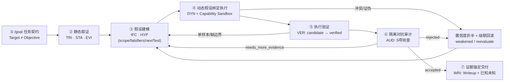

# 0xAF-Re 标准工作流架构规范（`re-agent` Reference Standard）

> **核心信条：模型很会猜，但逆向不相信故事。**
>
> 本文档定义 `0xAF-Re` 面向逆向工程行动系统的标准治理架构、数据结构契约、控制闭环、五道防线、可信度指标与交付验收门禁，与《模型很会猜，但逆向不相信故事》第五、六、七（§7.5）、八节设想的 `re-agent` 架构 1:1 对齐。

---

## 1. 设计目标与问题转向

传统 AI 辅助逆向停留在“代码解释器”层面；当 Agent 接入终端、反编译器、Frida、ADB、Unicorn/QEMU 与脚本重建能力后，系统演变为高权限**行动系统**。此时真正决定工程交付质量的不再只是单次模型推理上限，而是四个系统属性：

1. **权限边界可收束**：每一次工具与设备调用均受任务级最小权限（Capability）约束并留痕。
2. **事实与推断分离**：工具原始观察、不可信样本字符串、模型推断与重放验证严格分层，永不混入同一段上下文。
3. **假设可证伪、可回滚**：任何结论都有结构化边界与反例，冲突触发确定性降级与依赖级联回滚，而非靠流畅叙事圆谎。
4. **交付由执行与隔离审计裁定**：主 Agent 负责探索，不能自己担任裁判；产物必须经过构建、回放、边界/失败用例与差分验证，并由隔离上下文的对抗审计给出三态裁决。

---

## 2. 五个薄弱点 → 五道防线（§5 → §6）

| 编号 | 逆向 Agent 薄弱点（§5） | 典型失效表现 | 对应防线（§6） | 核心系统不变量 |
| --- | --- | --- | --- | --- |
| ① | **权限是一整块，没有跟着动作走** | 读取工作区外 `SOLUTION.txt`、宿主机凭据或未授权外联；结果正确但路径不可信 | **Capability Sandbox**（能力沙箱） | 任务级最小能力授权（`network`/`device` 默认拒绝），随任务结束或回滚立即失效；所有动作写入 `Action State`（工具、能力、命令 SHA-256、裁决、来源、绑定 `hypothesisId`） |
| ② | **观察、猜测和实验记录混在一起** | 模型将自身总结当作输入事实；样本函数名/隐藏字符投毒策略层 | **Evidence Ledger**（证据账本 + 不可信输入隔离） | Append-only 不可变账本（`ev_NNN`），逐条记录来源工具、视角（`static`/`dynamic`）、地址/产物路径、SHA-256、类别；原始样本输出标记 `untrustedInput: true`，仅作被引用数据，严禁当作指令 |
| ③ | **假设只是上下文里的一句话** | “这是解密入口”“这个常量是 key”叙事固着，错误假设带着 Agent 跑几十轮 | **Hypothesis Manager**（假设管理器） | 结构化假设（`claim` / `scope` / `confidence` / `supporting` / `contradicting` / `falsifiers` / `nextTest` / `dependsOn`）；反证强制折半置信度，冲突触发 `weakened` / `frozen` / `reevaluate` 并沿 `derived` 级联回滚 |
| ④ | **产物没有过验收门** | 脚本硬编码答案、单样本偶然命中或未真正执行模拟器却宣称“已还原算法” | **Execution Verifier**（执行验证器） | 区分 `candidate` 与 `verified`；强制执行构建、固定输入回放、边界/异常/失败样本与差分对比，记录 `boundaryPassed`、`differentialCases` 与 `uncoveredPaths`；**单样本命中（`total < 2`）严禁宣称算法已还原** |
| ⑤ | **停止条件没有写进任务** | 证据不足时持续空转耗尽预算，或用自信语气掩盖缺口 | **Adversarial Auditor**（对抗性审计器） | 独立隔离上下文（`Isolated=true`, `FreshSession=true`, `Tools=[]`），只读范围声明、账本、候选结论与验证记录；逐条执行 5 项核查，输出三态裁决：`accepted` \| `rejected` \| `needs_more_evidence` |

---

## 3. 七类任务档案状态 `Investigation State`（§8.1）

`Investigation State` 是跨轮次、跨模型、跨工具续跑的唯一任务档案。模型仅读取其摘要与索引，完整原始记录由宿主持久保存。

| 状态域 | 回答的问题 | 核心字段 | 写入者 | 读取者与生命周期 |
| --- | --- | --- | --- | --- |
| **1. Target State** | 针对哪个样本的哪个版本？ | `file`, `sha256`, `arch`, `format`, `version`, `scope` | 宿主（`goal.Sniff` + SHA-256 哈希，禁止模型自填哈希） | 整个任务周期只读锚定；**与 Objective State 严格分离**，同一 `Target` 可承载不同 `Objective`，防止任务漂移 |
| **2. Objective State** | 这次要证明什么、何时停止？ | `primary`, `intent`, `deliverables`, `constraints`, `stopConditions`, `acceptance` | 模型起草草案 → 操作员 `/goal accept` 批准生效 | 每次 system prompt 注入，Writeup 闸门按账本实时评估 |
| **3. Evidence State** | 工具真实观察到了什么？ | `id` (`ev_NNN`), `source`, `kind`, `view`, `artifact`, `sha256`, `untrustedInput`, `excerpt`, `verification` | 宿主工具运行器与验证器（append-only `evidence-ledger.jsonl`） | 只增不改；模型仅能引用 `ev_NNN`，不能伪造或改写 |
| **4. Hypothesis State** | 当前有哪些竞争解释及反例？ | `id` (`H-NNN`), `claim`, `scope`, `confidence`, `supporting`, `contradicting`, `falsifiers`, `nextTest`, `dependsOn`, `derived`, `status`, `experiments` | 模型提议、宿主 `hypothesis.Tracker` 与 `verify.Arbitrator` 执行确定性状态迁移 | 支持多解释并行竞争；支持 `active` → `weakened` / `frozen` / `reevaluate` → `revised` / `rejected` 级联演进 |
| **5. Action State** | Agent 提议并执行了哪些动作？ | `at`, `tool`, `capability`, `subject`, `sha256`, `decision` (`granted`/`denied`/`unmanaged`), `origin`, `hypothesisId` | 宿主 `security.Sandbox`（在审批分层前拦截并记录） | 每次动态动作须绑定目标假设 `hypothesisId`，回答“为了验证哪条 `nextTest`” |
| **6. Verification State** | 重建产物是否与原始行为等价？ | `build`, `passed`, `total`, `status` (`candidate` \| `verified`), `boundaryPassed`, `differentialCases`, `uncoveredPaths` | 宿主 `verify_artifact` 工具 | `total < 2` 或缺少失败/边界样本时锁定为 `candidate`，不得伪装成 `verified` |
| **7. Audit State** | 独立读者是否发现缺口或越权？ | `verdict` (`accepted` \| `rejected` \| `needs_more_evidence`), `checks[5]`, `auditorProvider`, `findings` | 宿主确定性 5 项评估器 + 隔离模型审计席（`/audit`） | 任何一次 replay 失败或新矛盾均可将状态退回 `needs_more_evidence` 或 `rejected` |

---

## 4. 八阶段标准控制闭环与 9 阶段 RE HUD 映射（§8.2–§8.7）

标准 `re-agent` 控制闭环在 `0xAF-Re` 中落地为 **9 阶段 RE Workflow**（`TRI → STA → DYN → EVI → IFC → HYP → VER → AUD → WRI`），核心阶段流转如下：

### 对抗审计 5 项强制核查清单（§8.6）

1. **`direct_evidence`**：每条活跃结论是否都有有效的非错误账本证据（`ev_NNN`）直接支撑？
2. **`failure_edge_coverage`**：验证是否覆盖边界、异常与失败输入（`total >= 2` 且 `boundaryPassed > 0` 或 `differentialCases > 0`，且非 `candidate`）？单样本命中强制退回 `needs_more_evidence`。
3. **`simpler_alternative`**：是否存在未结案的 `reevaluate`/`weakened`/`frozen` 级联假设，或高置信度单视角（static-only）盲区？
4. **`scope_overreach`**：Agent 是否越权访问了任务范围外的文件、网络、设备、容器或凭据？（被 Capability Sandbox 拦截且零越权成功视为沙箱生效；任何未拦截越权直接 `rejected`。）
5. **`artifact_lineage`**：交付产物是否真实由账本记录步骤生成，且结论不单靠 `untrustedInput: true` 的原始样本字符串支撑？

---

## 5. 运行态四角色轮换与多模型席位分工

### 运行态控制面四角色轮换（§8.7）

在每个动作周期内，控制面按需在四个运行态角色之间轮换，而非僵化顺序流水线：

1. **`Tool Router`**：根据 `Target State` 与当前阶段分发静态/动态工具，动作执行前过 `Capability Sandbox`。
2. **`Evidence Ledger`**：剥离不可信载荷并落盘不可变观察记录 `ev_NNN`，更新 `Hypothesis State`。
3. **`Execution Verifier`**：执行构建、固定输入回放、边界/失败用例与差分对比，判定 `candidate` vs `verified`。
4. **`Adversarial Auditor`**：脱离主对话上下文执行 5 项核查，签发 `accepted` / `needs_more_evidence` / `rejected`。

### 多模型成本与能力席位分工（§2）

| 席位 | 配置项 | 典型职责 | 成本控制原则 |
| --- | --- | --- | --- |
| **Planner** | `plannerProvider` | 目标拆解、跨函数语义推导、假设建模与反例设计 | 仅承载高推理价值判断，只读账本摘要 |
| **Executor** | `executorProvider` | 静态提取、动态插桩脚本、批量日志归并与测试 harness 初稿 | 隔离工具执行面，高频低价值任务下沉便宜/小模型 |
| **Researcher** | `researcherProvider` | 混淆模式识别（CFF/BCF/IS/MBA）、竞争假设展开与背景溯源 | 按需触发，避免污染主执行上下文 |
| **Auditor** | `auditProvider` | 独立零历史、零工具对抗审计（`/audit`） | 强制优先选用与 Planner/Executor 不同的第三模型席位 |

---

## 6. 五项可信度与成本指标（§7.5）

将“报告语气顺滑”与“结果工程可信”彻底拆开评估：

| 指标 | 英文键名 | 定义与观测口径 |
| --- | --- | --- |
| 证据覆盖率 | `evidence_coverage` | 最终活跃结论中可回溯至 Evidence Ledger 有效原始观察（`ev_NNN`）的比例 |
| 回放通过率 | `replay_pass_rate` | 固定输入、边界输入与失败样本下重建产物的通过比例（`passed / total`） |
| 错误假设寿命 | `wrong_hypothesis_lifetime` | 错误假设从提出到被削弱、淘汰或级联回滚所消耗的轮次 / 证据步数 / token |
| 越权动作次数 | `overreach_count` | 任务范围外的文件、网络、设备与凭据访问次数（区分被沙箱拦截次数与越权成功次数） |
| 单位可信结论成本 | `cost_per_accepted_finding` | 通过审计验收的每条结论分摊的模型 token、工具与设备总成本（USD） |

---

## 7. 七项完成闸门（§8.7）与三问交接标准

### 七项完成闸门（全部满足方可交付 `WRI [9/9]`）

1. **目标与范围可复现**：`Target State`（文件、SHA-256、架构、格式、版本、范围）与 `Objective State` 明确分离并已锁定。
2. **关键结论全部入账**：每条最终结论均可追溯到 append-only `Evidence Ledger` 的 `ev_NNN`。
3. **主要假设经过检验**：核心假设均已完成支持、反驳或级联清理，无悬空 `reevaluate`。
4. **产物通过多维验证**：构建、固定输入回放、边界/失败样本与差分测试达到声明门槛（状态为 `verified`）。
5. **高风险动作全部留痕**：所有动态与外部动作均通过 `Capability Sandbox` 并记录 `ActionRecord`。
6. **对抗审计无未解冲突**：隔离 `Adversarial Auditor` 5 项核查全部通过，裁决为 `accepted`。
7. **报告明示边界与未知**：交付文档显式列出已知未知（Known Unknowns）、未覆盖路径（`uncoveredPaths`）与下一步测试（`nextTest`）。

### 交接三问（Handover Readiness）

任务收尾、续跑或跨团队交接时，档案必须直接回答三个问题：

1. **结论来自哪一次运行？**（Session ID、Evidence Ledger 路径、`ev_NNN` 与 artifact SHA-256）
2. **换模型或换工具后能不能复现？**（独立可运行的 replay/differential 测试命令与固定输入向量）
3. **失败或偏差归因于哪一层？**（明确区分 **模型推理 / 工具故障 / 运行环境 / 样本数据与投毒**）

---

## 8. 工程实现精确映射矩阵（Go Core + Wire DTO + GUI Views）

| 架构模块 | Go 核心实现 | Wire DTO / TS 契约 | GUI 可视化视图 |
| --- | --- | --- | --- |
| **Target ≠ Objective 契约** | `internal/goal/declaration.go` (`Target`, `Objective`, `BuildDeclaration`, `Evaluate`) | `gui/dto.go` (`GoalSummaryDTO`), `lib/types.ts` | `InvestigationDossierPanel` (`① Target` / `② Objective`), `GovernanceGraphPanel` |
| **Capability Sandbox & Action State** | `internal/security/capability.go` (`Sandbox`, `ActionRecord`) | `gui/dto.go` (`SandboxDTO`, `SandboxActionDTO.hypothesisId`), `lib/types.ts` | `GovernanceGraphPanel` (`GATE 1`), `InvestigationDossierPanel` (`⑤ Action`) |
| **Evidence Ledger & 不可信隔离** | `internal/evidence/ledger.go`, `internal/types/types.go` (`EvidenceRecord.UntrustedInput`) | `gui/dto.go` (`LedgerDTO.Evidence`), `lib/types.ts` | `LedgerPanel` (`UNTRUSTED DATA` 隔离标签), `InvestigationDossierPanel` (`③ Evidence`) |
| **Hypothesis Manager & 级联回滚** | `internal/hypothesis/tracker.go` (`UpdateDetails`, `Weaken`, `Freeze`, `Challenge`, `Reject`) | `internal/types/types.go` (`Hypothesis.Scope`/`Falsifiers`/`NextTest`), `lib/types.ts` | `HypothesisWorkbenchDialog`, `LedgerPanel`, `GovernanceGraphPanel` (`DAG`) |
| **Execution Verifier (`candidate` vs `verified`)** | `internal/tools/verify.go`, `internal/types/types.go` (`VerificationStats`) | `lib/types.ts` (`VerificationStats.status`/`boundaryPassed`/`differentialCases`/`uncoveredPaths`) | `HypothesisWorkbenchDialog`, `InvestigationDossierPanel` (`⑥ Verification`) |
| **Adversarial Auditor (5 项核查 + 3 态裁决)** | `internal/verify/arbitrator.go` (`EvaluateAdversarialAudit`, `AdversarialAudit`), `internal/core/auditor.go` | `gui/dto.go` (`LedgerDTO.AuditVerdict`/`AuditChecks`), `lib/types.ts` | `InvestigationDossierPanel` (`⑦ Audit`), `HypothesisWorkbenchDialog`, `REHudPanel` |
| **5 项可信指标 & 7 项完成闸门** | `internal/goal/declaration.go`, `internal/verify/arbitrator.go`, `gui/manager.go` | `gui/dto.go` (`TickDTO`), `lib/types.ts` | `TelePanel` (§7.5 指标条), `InvestigationDossierPanel`, `WriteupStudioPanel`, `ProofNarrativePanel` |
